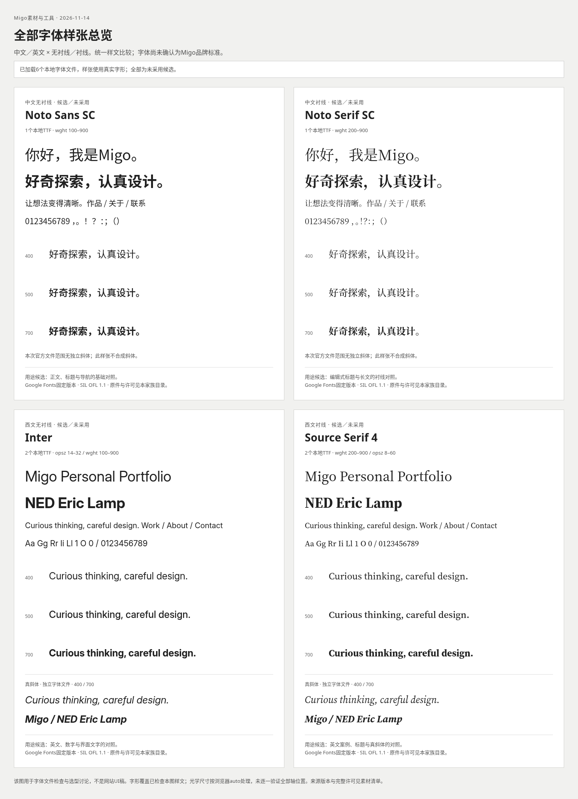
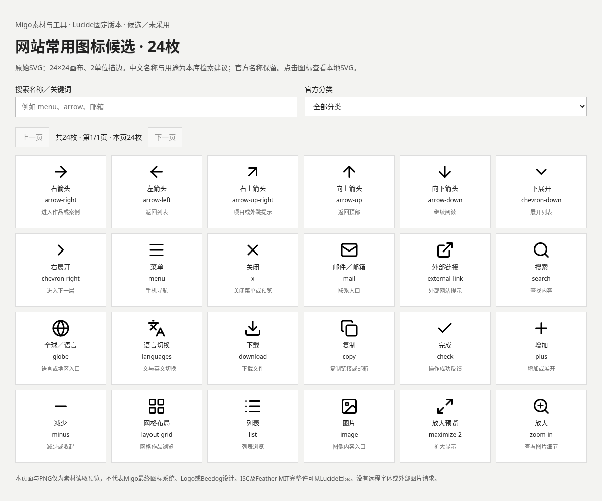

# 素材与工具

这里保存**实际可读取的文件**和已有工具的入口。资源导览负责“到哪里找”，设计研究库负责“怎样理解与迁移”，本模块负责“文件是什么、能否读取、可否使用、项目是否采用”。三者互相链接，分别维护。

首批入库日期：2026-11-14。当前包含 **4个字体家族（6个可变TTF文件）、Lucide完整套装2,055枚SVG图标、1套CSS设备样机，121个插画原件（120个SVG、1个PNG）、2张摄影JPEG和4张材质JPEG**，全部是未采用候选，尚未被Migo确认为品牌字体、图标系统或项目采用资产。既有商业提案工具继续保存在原目录。

| 入口 | 内容 |
| --- | --- |
| [素材总索引](素材总索引.md) | 原件位置、用途、许可、读取与采用状态 |
| [入库与使用规范](入库与使用规范.md) | 下载核验、预览、命名、许可证、跨项目使用记录 |
| [字体](字体/README.md) | 中文／英文的无衬线与衬线四家族，每家独立PNG与汇总预览 |
| [字体下载范围与来源](字体/管理资料/字体下载范围与来源.md) | 选择依据、6个目标字体文件、官方来源及本轮停止条件 |
| [图标](图标/README.md) | Lucide完整SVG集、24枚常用候选预览、九页总览与中文分类索引 |
| [样机](样机/README.md) | 已入库1套MIT许可CSS设备样机，验证电脑／手机／平板三种；PSD仅保留已核查候选入口 |
| [插画与矢量图](插画与矢量图/README.md) | 87个背景图案、33个人物／动物SVG、1个立体笔记本PNG，每套与总目录均附预览 |
| [摄影图片](摄影图片/README.md) | 两张历史CC0完整原图，工作台与窗边场景，附实际预览 |
| [材质与纹理](材质与纹理/README.md) | Poly Haven四张2K颜色贴图，木材、织物、旧金属、灰泥 |
| [整理进度](整理进度.md) | 已完成批次、PSD核查、后续整理顺序与停止条件 |
| [工具](工具/README.md) | 现有HTML提案工具、PDF与在线工具入口，区分本地文件与外部服务 |
| [本地交互样张](预览/素材样张.html) | 下载完整目录后用浏览器打开；也可运行本地HTTP服务 |
| [机器可读清单](素材清单.json) | 固定来源提交、下载链接、SHA256、字形与文件检查记录 |

## 在GitHub先看这张图

下面是全部在库字体家族的汇总样张，使用实际本地文件渲染，**不代表Migo网站UI方案**。每个家族目录还有独立样张，完整检查范围见[字体批次验收记录](字体/管理资料/字体批次验收记录.md)。

[查看首批六枚图标与原字体样张](预览/首批素材样张.png) · [首批入库验收记录](首批入库验收记录.md)。历史首批资料保持原样，当前完整字体范围以本目录与清单为准。

## 常用图标先看这一张

[查看完整2,055枚图标与分页预览](图标/README.md)。SVG原件合计827,519字节，约0.83 MB；PNG、HTML、索引与来源记录另计。未将本轮图标应用到网站或品牌设计。

## 怎样打开实际文件

1. 字体：进入对应目录下载TTF。支持可变字体的软件可以加载或安装使用；GitHub通常不提供字体字形预览，所以先看上面的PNG样张。软件的可变字重支持需要另测。
2. 图标：直接查看SVG，或下载后在浏览器、Figma、Illustrator等支持SVG的工具中打开。这里仅检查浏览器读取，不冒称所有软件均已验证。
3. 插画：先看[全部预览](插画与矢量图/全部素材预览.png)，进入套装查看原件。SVG与PNG区分格式，Hero Patterns须署名；完整来源和许可见各套装README。
4. HTML样张：GitHub文件页显示源码。下载仓库后保持目录结构，打开`素材与工具/预览/素材样张.html`；若浏览器限制本地字体加载，在仓库根目录执行`python -m http.server 8000`，再访问`http://localhost:8000/素材与工具/预览/素材样张.html`。无需安装字体、依赖包或联网字体服务。
5. AI读取：在能访问仓库文件的任务中，先查清单，再读取原件或PNG。字体需要解析元数据和字形，SVG需要查看结构与实际图形；仅知道下载链接不代表已经看过。后续新会话也需要重新定位文件，不会永久自动加载整个素材库。

Noto Sans SC原始TTF约17.8 MB，Noto Serif SC约25.1 MB，六个字体文件合计约46.75 MB，当前用于归档与样张验证。正式网站不能未经性能评估直接整包加载；若将来做WOFF2转换或字形子集，应另外记录派生版本、字形范围、工具版本、许可及浏览器验证。

## 当前边界

已下载少量摄影与材质JPEG；没有下载受限字体、付费样机、PSD、AI源文件或软件安装包；没有修改Migo品牌项目、NED案例和网站，也没有部署新页面。网页参考案例继续在[资源导览](../资源导览/README.md)与[设计研究库](../设计研究库/README.md)维护。

更新后运行`python 素材与工具/脚本/校验素材.py`，并运行仓库既有研究索引检查。不要把文件入库、浏览器可读、用户认可、项目采用混为一项状态。
