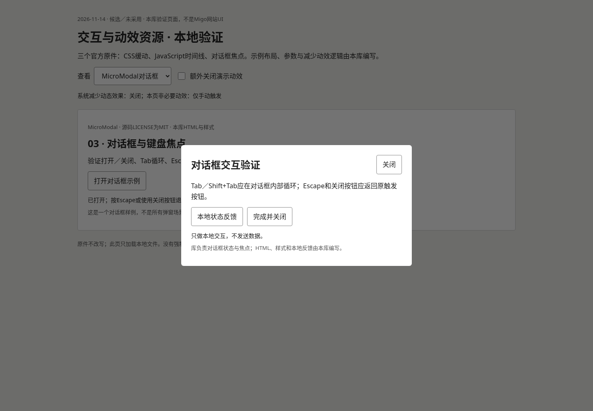

# MicroModal对话框

2026-11-14入库。作者：Indrashish Ghosh及贡献者；来源版本：固定源码快照：文件头v0.7.3，package.json为0.7.0。**候选／未采用**。

[手机预览](手机预览.png) · [实际运行演示](../管理资料/交互演示.html)

## 原件与实际版本

保存[对话框.js](原件/对话框.js)，来自官方仓库`src/index.js`，16,898字节，独立ES Module，没有外部import。本库用`import MicroModal from ...`加载；没有下载或声称使用npm编译包。

固定提交中的元数据有差异，必须保留：源码头写`v0.7.3`，[package.json](https://github.com/micromodal/Micromodal/blob/0a46e81fca52a332a70d1b7d399d8fce47504a04/package.json)写版本`0.7.0`和许可`ISC`，同一提交的[LICENSE.md](https://github.com/micromodal/Micromodal/blob/0a46e81fca52a332a70d1b7d399d8fce47504a04/LICENSE.md)明确为MIT。

本批归档具体源码，按源码根MIT声明完整保留；不把package字段当作ISC许可原文，也不把该快照称为已核实的npm 0.7.3发行版。以后若通过npm采用，应重新核对实际安装包及其声明。

## 对话框验证与职责

库负责打开／关闭、aria-hidden状态、焦点与键盘逻辑。HTML结构、外观、本地反馈按钮和操作说明由本库编写，未复制官方站点内容。

本样例初始化后打开时，源库选择首个**非关闭按钮**作为焦点，即“本地状态反馈”；双向Tab边界另行测试。已验证Enter打开、Tab／Shift+Tab循环、内部按钮反馈、Escape、关闭／完成按钮和遮罩退出，以及Escape／按钮退出后焦点返回。

正常与reduce模式都不添加弹窗位移或缩放，不等待animationend来关闭；另在390px触控模拟中检查打开与关闭。手机PNG为打开状态，不能证明屏幕阅读器或所有设备表现。

可以研究焦点与可逆状态，不应把一个样例通过当作全套无障碍认证。现代浏览器还可评估原生dialog；这里保留比较资源，不强制网站引入该库。嵌套、动态移除、复杂表单和Shadow DOM未验证。

[官方源码仓库](https://github.com/micromodal/Micromodal)

## 来源与完整性

[固定提交](https://github.com/micromodal/Micromodal/tree/0a46e81fca52a332a70d1b7d399d8fce47504a04)：`0a46e81fca52a332a70d1b7d399d8fce47504a04`。原件按官方Git blob和本地SHA256校验，原路径与下载URL见[统一清单](../../素材清单.json)。

[源码许可证完整原文](源码许可证.txt)来自[同一官方提交](https://github.com/micromodal/Micromodal/blob/0a46e81fca52a332a70d1b7d399d8fce47504a04/LICENSE.md)；使用／再分发时保留适用版权和许可，不用仓库根MIT替换它。原件仅外部中文命名，内容未改。

[集中检查记录](../管理资料/动效检查记录.json) · [返回交互与动效目录](../README.md)
