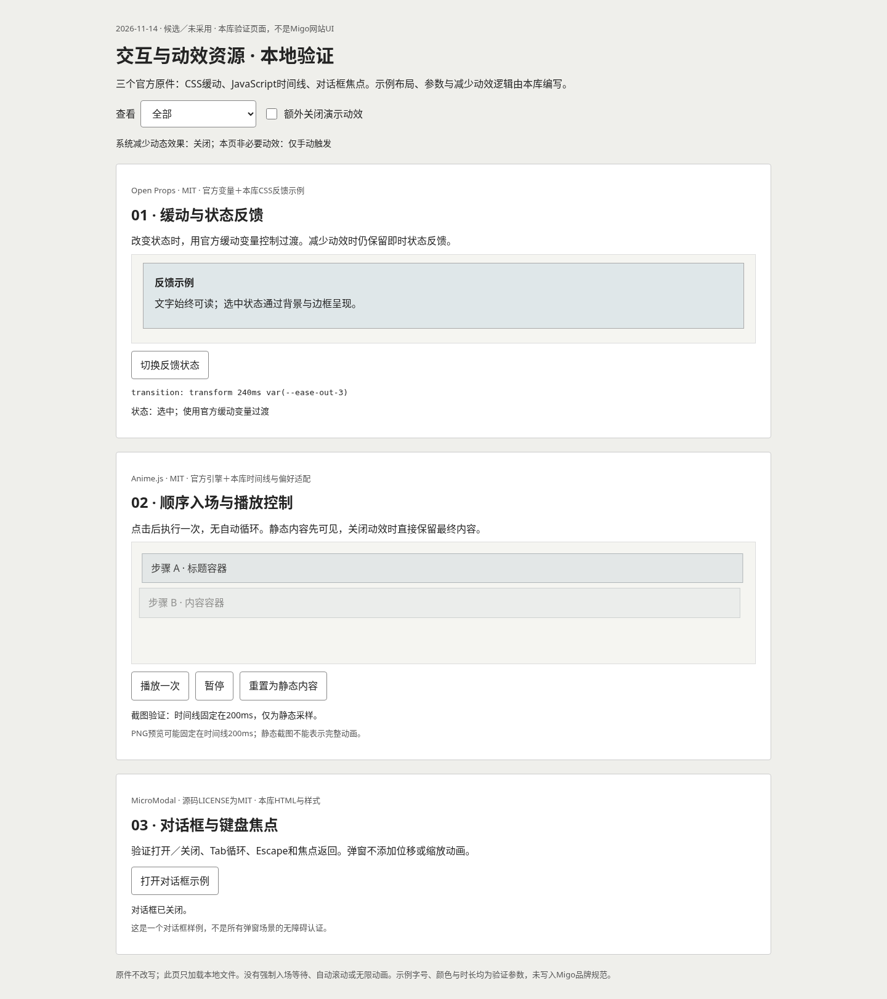
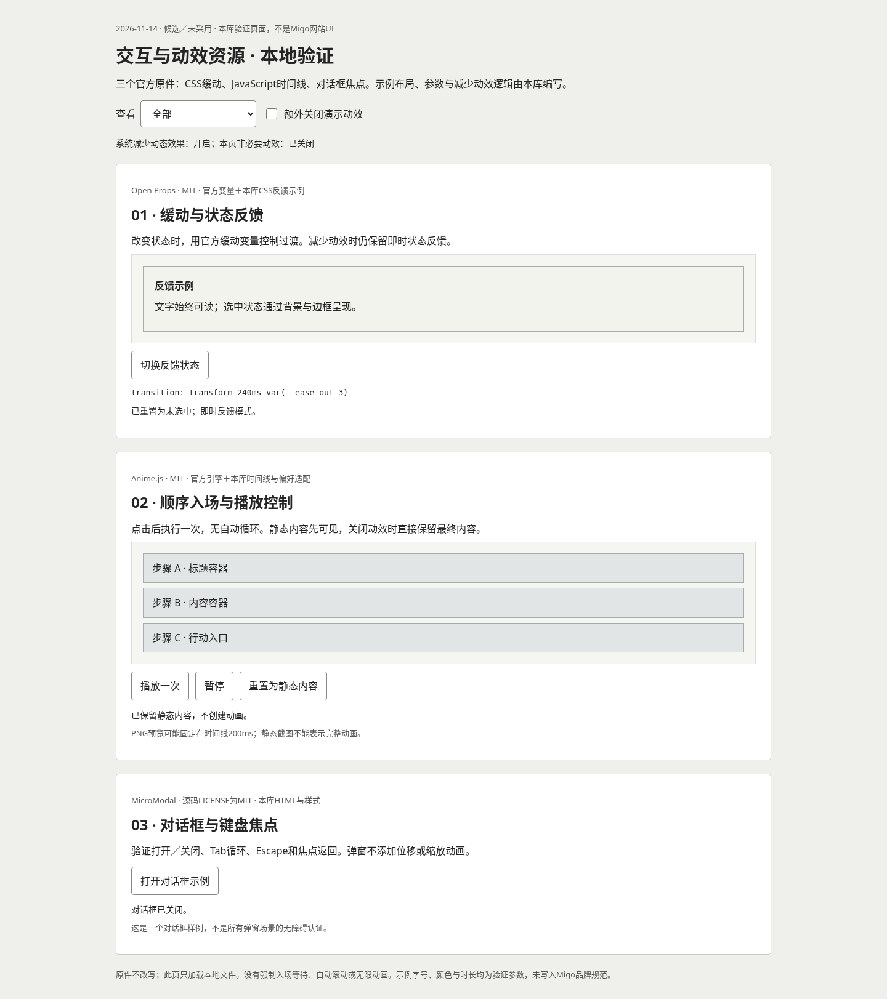

# 交互与动效资源

2026-11-14首批入库：**三套资源、三个官方原件，共141,356字节（约141.36 KB）**。许可、演示、PNG与检查记录另计。全部为候选／未采用，未接入Migo品牌或网站。

| 资源 | 实际文件与大小 | 用途 | 减少动效的责任 |
| --- | --- | --- | --- |
| [Open Props缓动变量](Open_Props缓动/README.md) | 1个CSS，6,415字节 | 研究过渡的节奏与缓动参数 | 变量文件本身不创建动画；反馈组件及回退逻辑由本库编写 |
| [Anime.js动画引擎](Anime_JS/README.md) | 1个UMD JavaScript，118,043字节 | 顺序入场、时间线、暂停与重置 | 本库主动读取偏好、取消运行中动画并恢复静态内容 |
| [MicroModal对话框](MicroModal对话框/README.md) | 1个独立ESM源码，16,898字节 | 对话框状态、焦点与键盘退出 | 本样例不添加弹窗位移／缩放，不依赖动画结束来关闭 |

三套保存各自完整源码MIT声明。MicroModal的源码头、包版本与许可字段有差异，详见对应说明；未将npm元数据冒充实际源码许可证。

## 怎样看真正的交互与动画

PNG只展示静态采样。Anime.js的普通截图固定在时间线200ms，不能据此判断完整动画；对话框截图展示打开状态。动态效果请用[本地交互演示HTML](管理资料/交互演示.html)实际操作。

GitHub文件页显示HTML源码，不直接运行。下载并保留整个目录结构，从仓库根目录运行`python -m http.server 8000`，再打开`http://localhost:8000/素材与工具/交互与动效资源/管理资料/交互演示.html`。MicroModal为ES Module，建议使用本地HTTP服务而非双击文件。

演示不需npm、构建或远程CDN。可手动切换反馈状态、播放／暂停／重置时间线、打开／关闭对话框；页面不自动循环、不强制等待入场、不滚动劫持。示例文案、颜色、位移、时长和排列由本库编写，不是库附带成品组件或Migo最终UI。

## 减少动态效果怎样处理

演示读取真实`prefers-reduced-motion: reduce`媒体查询，并提供“额外关闭演示动效”开关。关闭页面开关不能覆盖系统已开启的减少动效偏好。

- 反馈状态仍即时更新，取消非必要位移和过渡。
- 时间线运行中变更偏好，会取消动画并恢复全部内容；减少模式点击播放不创建新的示例时间线。
- 恢复普通模式后等待手动播放，不自行补播。
- 对话框在两种模式均保留打开、关闭和键盘操作。

这些判断与回退由本库演示层负责，不能推断为三个源库自动对所有项目提供的行为。也没有据此修改上一批官方彩纸示例的原件。

## 选择依据、来源与停止条件

选择互补的CSS参数、JavaScript时间线和对话框焦点机制，便于理解“状态反馈”“动画执行”“输入与焦点管理”的职责。只下载这三个固定提交文件及许可；未下载网站设计、角色动画、第三方照片、整站文档、框架专用包、其他构建格式或sourcemap。

本轮核对但未入库的候选：

| 候选 | 官方核查结果 | 本批处理 |
| --- | --- | --- |
| [Animate.css许可](https://github.com/animate-css/animate.css/blob/3f8ab233dbbd9d2fe577528d2296382954be3d1a/LICENSE) | 当前LICENSE与package.json为Hippocratic-2.1，不能当作MIT声明 | 保留入口，不纳入本批MIT源码集，不据此否认其他合法使用方式 |
| [Hover.css](https://github.com/IanLunn/Hover/blob/eb8629df13850d78bbcccd4fed68d231aec0c535/license.txt) | 条款区分个人／开源与商业许可，不能简化为无条件商业MIT | 只保留来源与核查说明，未上传原件 |

各原件作者、固定提交、原始下载URL、Git blob、SHA256、版本及读取状态在[统一清单](../素材清单.json)维护，不再为每个库增加一份元数据JSON。原件字节不改，只改外部中文文件名。

## 验证证据与边界

已在Chromium检查正常模式、系统reduce和页面额外关闭开关，记录CSS实际过渡、时间线运动／暂停／完成／重置、运行中取消、对话框双向Tab循环、Escape、三种按钮／遮罩退出及焦点返回。手机390px另做触控模拟。桌面／手机六张PNG、总览和减少动效共八张，检查时没有外部网络请求。

这不是完整无障碍审计、所有缓动曲线或所有Anime.js API验收，也不涵盖真实设备、读屏、嵌套弹窗、性能指标或浏览器全矩阵。真实项目需先决定是否需要动画；原生CSS／Web Animations／dialog也可满足部分任务，不因下载就必须引入库。

[检查记录](管理资料/动效检查记录.json) · [重建与验证脚本](../脚本/生成动效资源预览.py)。脚本需Playwright与Chromium，只读本地原件，不下载、不改写源库或网站。

## 与已有研究的关系

参考[已有Dennis结构与交互研究](../../设计研究库/04_网站与数字体验案例/Dennis-Snellenberg-结构交互与动效.md)中“普通浏览路径优先、状态可逆、作品信息不依赖hover”的方法与证据边界。本轮没有重新操作Dennis网站，不复制其源码、曲面遮罩、人物图像或精确动效参数；本批只验证独立资源，Migo项目尚未采用。

[整理进度](../整理进度.md) · [返回素材与工具](../README.md)
