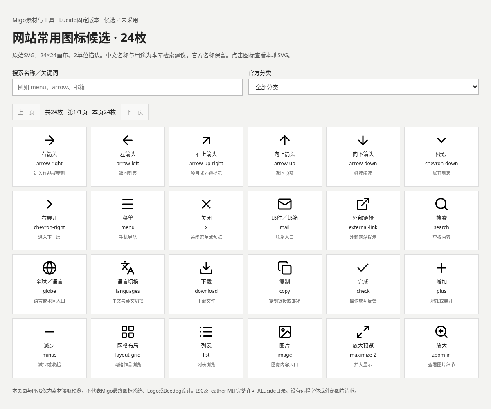

# Lucide图标候选库

当前入库：**固定版本全部2,055枚SVG**，包含原有六枚，新增2,049枚；原件总计827,519字节，约0.83 MB。整套为未采用候选，常用项由AI按功能用途整理，尚未确认为Migo图标系统。

## 常用24枚先看这一张



覆盖返回、进入、菜单、关闭、邮箱、搜索、语言、下载、复制、布局与图片预览等功能。中文名称和用途是本库建议；图标不能代替清楚的按钮文字与无障碍名称，24×24画布也不是手机点击区域尺寸。

## 全部图标预览

按官方名称排序，每页最多240枚，九页覆盖完整套装。PNG可直接在GitHub查看；更精确查找请用[名称与中文分类索引](图标索引.md)。

| 页码 | 数量 | 官方名称范围 | 预览图 |
| --- | ---: | --- | --- |
| 01 | 240 | a-arrow-down → braces | [打开第1页](全部图标预览/图标总览_01.png) |
| 02 | 240 | brackets → clipboard-pen | [打开第2页](全部图标预览/图标总览_02.png) |
| 03 | 240 | clipboard-plus → file-key | [打开第3页](全部图标预览/图标总览_03.png) |
| 04 | 240 | file-lock → images | [打开第4页](全部图标预览/图标总览_04.png) |
| 05 | 240 | import → microwave | [打开第5页](全部图标预览/图标总览_05.png) |
| 06 | 240 | midi-port → refresh-ccw-dot | [打开第6页](全部图标预览/图标总览_06.png) |
| 07 | 240 | refresh-ccw → square-divide | [打开第7页](全部图标预览/图标总览_07.png) |
| 08 | 240 | square-dot → underline | [打开第8页](全部图标预览/图标总览_08.png) |
| 09 | 135 | undo-2 → zoom-out | [打开第9页](全部图标预览/图标总览_09.png) |

## 原件、来源与许可

- 官方来源：[lucide-icons/lucide固定提交](https://github.com/lucide-icons/lucide/tree/55782beff3a0133df79c417eb68f96e8f19e2404)；[官网图标目录](https://lucide.dev/icons/)。
- 版本：`55782beff3a0133df79c417eb68f96e8f19e2404`。当前为归档基线，不自动代表上游最新版本。
- 原件：[Lucide目录](Lucide/)，原有六枚中文文件保留原路径；新增文件保持官方名称，放在图标原件的A-C、D-H、I-P、Q-Z四组，每组少于1,000枚，避免GitHub单目录列表过长。索引可定位全部文件。
- 完整许可：[ISC与Feather衍生图标MIT原文](Lucide/图标许可证.txt)，原文保持不变。复制SVG到项目时，也保留适用版权与许可声明，不能用仓库根MIT代替。
- 每枚原始文件名、来源链接、Git blob SHA1、本地SHA256、官方分类与贡献者见[统一素材清单](../素材清单.json)。

## 下载边界和读取范围

本轮只收这一固定提交的`icons/*.svg`，不下载其他网站、不生成Migo Logo或Beedog、不开发网站。官方源包仅用于获取该目录；源码包保存在临时工作目录，未把整套应用源码或额外安装包提交到仓库。从官方每枚JSON提取分类、普通关键词与贡献者并入总清单，分类继承单独解析；不另存2,055个JSON文件。

43个分类来自官方元数据，包括其分类继承关系；中文名称为本库检索翻译。官方分类可能一枚多类，分类数量不能与图标数量直接相加。SVG原件均经过官方Git blob、文件哈希、XML、24×24画布、描边及外部引用检查。分页读取与人工看图范围另记在管理资料，不将文件可读当作逐枚审美评估。

## 简明目录

```text
图标/
├── README.md
├── 常用图标预览.png
├── 图标索引.md
├── 全部图标预览/       # 九页PNG
├── Lucide/             # SVG原件与一份完整许可
└── 管理资料/           # 一份HTML和一份检查JSON
```

[可搜索HTML](管理资料/图标样张.html)在GitHub文件页显示源码；下载完整目录后用浏览器打开，可按官方名称、英文关键词、中文分类和常用中文名称搜索，也可筛选分类、翻页。HTML只读本地SVG；不会自行上传文件、修改采用状态或推送GitHub。PNG、索引及管理资料的体积另计，不包含在0.83 MB的SVG原件数值中。

维护入口：[生成图标预览脚本](../脚本/生成图标预览.py)，在仓库根目录运行，需要Playwright和Chromium。HTML与检查JSON统一写入管理资料，PNG保留在本目录；随后运行[素材校验](../脚本/校验素材.py)。
