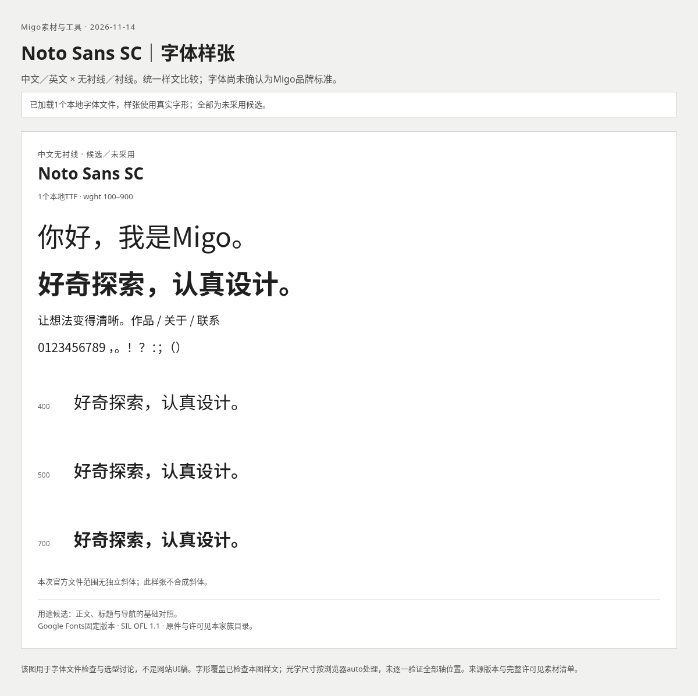

# Noto Sans SC｜字体候选

分类：中文无衬线。用途候选：正文、标题与导航的基础对照。**用户未确认，项目未采用。**

## 直接看样张

[打开本地HTML样张](字体样张.html) · [全部字体预览](../全部字体预览.png) · [下载范围与来源](../字体下载范围与来源.md)

## 实际字体文件

| 编号 | 原件下载 | 样式 | 大小 | 可变轴范围 |
| --- | --- | --- | ---: | --- |
| 字001 | [简体无衬线可变.ttf](简体无衬线可变.ttf) | 直立体 | 17.77 MB | wght 100–900 |

可变字体用一个文件覆盖所列字重范围，无需重复下载相同字重的静态版本。`wght`表示字重；`opsz`表示光学尺寸，用于适应不同文字尺寸，并非字号本身。样张展示400／500／700及所收真斜体的400／700，未逐一检查全部轴位置。

## 来源与许可

- 官方介绍：[家族页面](https://fonts.google.com/noto/specimen/Noto+Sans+SC)。
- 实际分发：[Google Fonts指定版本的本家族目录](https://github.com/google/fonts/tree/29b4ec6df2522a8aee279414b78a07910b065874/ofl/notosanssc)。
- 本地附[完整OFL 1.1](字体许可证.txt)与[官方METADATA原文](官方字体元数据.txt)，二者版权声明按原样保存。
- 每个文件原名、下载URL、官方Git blob SHA1、本地SHA256与字体版本见[素材清单](../../素材清单.json)。
- 本目录中文文件名只是本库外部命名，字体内部名称和原始二进制未修改。

## 使用与检查范围

样张中文、数字和标点已检查字形映射并用本地文件渲染；不声称全字库每个字都已视觉检查。官方选定目录本轮无独立斜体，样张关闭字体合成，不用人为倾斜充当真斜体。中文完整TTF体积较大，正式网页接入前另做性能与字形范围评估。

已在Chromium实际加载并生成PNG；尚未测试PS、AI、Figma及全部操作系统安装行为。GitHub直接显示上方PNG；HTML需下载并保持目录结构，本地字体加载受限时从仓库根目录运行`python -m http.server 8000`。

[字体批次验收记录](../字体批次验收记录.md) · [返回字体目录](../README.md)
