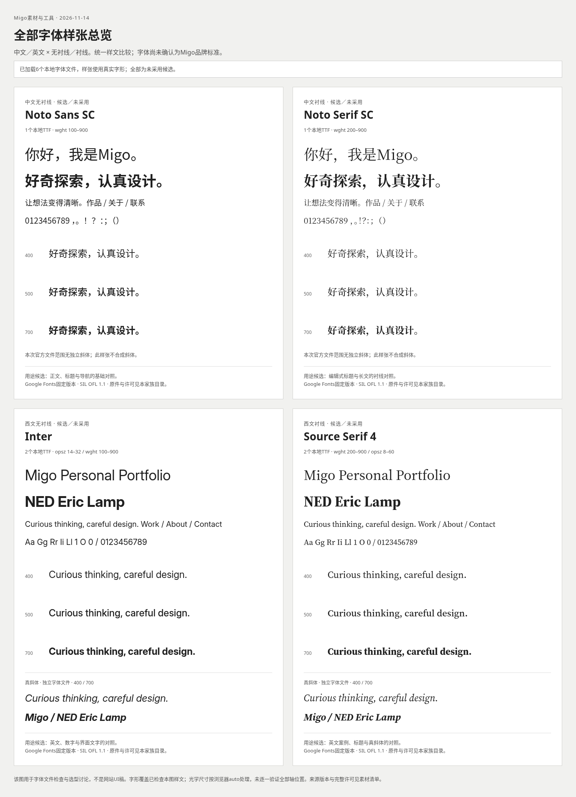

# 字体候选库

当前范围：**4个字体家族、6个可变TTF文件，总计46.75 MB**。全部为AI整理的候选，尚未确认为Migo品牌字体或网站采用方案。下载边界是指定家族在固定官方版本中的可变TTF文件，详见[选择依据与来源](管理资料/字体下载范围与来源.md)。

## 全部字体预览

每个家族目录只放**字体文件、PNG样张、许可证和README**。日常浏览先看本页汇总图，进入家族目录即可下载字体。

## 每个家族都有独立样张

| 家族 | 分类与比较用途 | 文件 | 独立PNG |
| --- | --- | --- | --- |
| [Noto Sans SC](Noto_Sans_SC/README.md) | 中文无衬线；正文、标题与导航的基础对照 | 1个TTF | [直接看样张](Noto_Sans_SC/字体样张.png) |
| [Noto Serif SC](Noto_Serif_SC/README.md) | 中文衬线；编辑式标题与长文的衬线对照 | 1个TTF | [直接看样张](Noto_Serif_SC/字体样张.png) |
| [Inter](Inter/README.md) | 西文无衬线；英文、数字与界面文字的对照 | 2个TTF | [直接看样张](Inter/字体样张.png) |
| [Source Serif 4](Source_Serif_4/README.md) | 西文衬线；英文案例、标题与真斜体的对照 | 2个TTF | [直接看样张](Source_Serif_4/字体样张.png) |

两款中文家族各1个字体文件，两款西文家族各含直立体与真斜体。中文目录共4个文件，西文目录共5个文件。

HTML、JSON检查记录、来源元数据及下载／验收说明统一放在[管理资料](管理资料/)，需要查来源或维护时再打开。素材模块仍使用一份[总清单](../素材清单.json)，字体目录不再单独放清单。

## 如何理解这些字体

- 无衬线：笔画末端通常没有装饰性衬线，本批用于正文、导航与界面文字的基础比较。
- 衬线：笔画末端带衬线等结构特征，本批用于编辑式标题和长文的对照；具体效果仍受字号、字重和布局影响。
- 可变字体：一个文件覆盖一段字重或其他轴范围，并非只含某一个静态字重。
- 真斜体：官方独立斜体文件，区别于软件把直立体简单倾斜。本批中文字体未生成斜体。

这些说明用于选择，不把“无衬线＝一定现代”或“衬线＝一定高级”当作品牌结论。

## 来源、维护与限制

实际来源：[Google Fonts官方GitHub固定版本](https://github.com/google/fonts/tree/29b4ec6df2522a8aee279414b78a07910b065874)。原始单文件链接和SHA256见[素材清单](../素材清单.json)；每家族单独保存OFL 1.1原文，不能由仓库根MIT替代。

源TTF用于归档和查看，正式网站需另外评估WOFF2、子集与加载策略。未确认最终配对、用户偏好或项目采用；未验证所有软件与操作系统安装。

重建与检查说明集中在[管理记录](管理资料/字体批次验收记录.md)；脚本输出的HTML与检查JSON也放入管理资料，不重新散落到字体家族目录。

历史首批[两字体与六图标样张](../预览/首批素材样张.png)继续保留，本目录总览展示当前全部四个字体家族。
