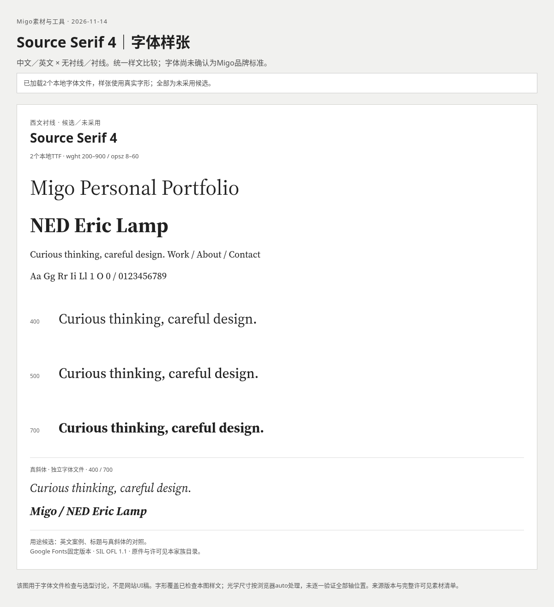

# Source Serif 4｜字体候选

西文衬线。用途候选：英文案例、标题与真斜体的对照。当前未采用。

## 下载字体

| 文件 | 样式 | 字重范围 |
| --- | --- | --- |
| [西文衬线可变.ttf](西文衬线可变.ttf) | 直立体 | 200–900 |
| [西文衬线可变斜体.ttf](西文衬线可变斜体.ttf) | 真斜体 | 200–900 |

可变字体的一个文件覆盖上述多个字重；PNG样张可在GitHub直接查看。

## 来源与版本

- 来源：[Google Fonts官方固定版本](https://github.com/google/fonts/tree/29b4ec6df2522a8aee279414b78a07910b065874/ofl/sourceserif4)；[上游／官方介绍](https://github.com/adobe-fonts/source-serif)。
- 字体版本：Version 4.004;hotconv 1.0.116;makeotfexe 2.5.65601。
- 许可：[SIL OFL 1.1完整原文](字体许可证.txt)，下载或再分发字体时请一起保留。
- 技术记录与原始元数据统一在[管理资料](../管理资料/)，家族名与字体二进制保持原样。

[查看全部字体](../README.md) · [全部字体预览图](../全部字体预览.png)
