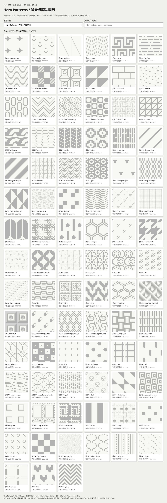

# 背景与辅助图形｜Hero Patterns

2026-11-14入库；87个SVG原件。**候选／未采用**。

## 来源与范围

作者：[Steve Schoger／Hero Patterns](https://heropatterns.com/)。官方源仓库固定提交：[sschoger/hero-patterns](https://github.com/sschoger/hero-patterns/tree/6a2ed74a6910a8b1095d15dd31f7f3f0188517ad)。本批仅收录该提交`svg/`中87个ZIP各自包含的原始SVG；合计237,558字节，不含容器、Sketch文件或网站程序。

每个原件保留官方导出的内容，文件名沿用ZIP对应主题。统一清单区分ZIP容器的Git blob与解压SVG的SHA256，不能将容器提交校验冒称SVG本身的Git blob。

## 许可与署名

官网明确采用[CC BY 4.0](https://creativecommons.org/licenses/by/4.0/)。完整法律文本见[素材许可证](素材许可证.txt)，文本来自固定版本[SPDX许可文本镜像](https://raw.githubusercontent.com/spdx/license-list-data/31846481de7ea17d92f2f46fad76abe58b2e9bb0/text/CC-BY-4.0.txt)，作品的授权依据仍是作者官网，而非SPDX。未套用仓库中第三方控件的MIT许可。

使用或再分发时保留适用署名、来源、许可链接及修改说明。可复用：

> Hero Patterns by Steve Schoger — https://heropatterns.com/ — CC BY 4.0: https://creativecommons.org/licenses/by/4.0/。原始SVG未修改；本库预览做缩放、重复平铺及透明度调整。

## 用法与限制

适合测试背景密度、分区纹理和辅助图形的节奏。预览采用低透明度平铺，不改变原件颜色。具体项目需要重新测试对比、图案密度及是否干扰正文；主题名称或整套入库不代表适合Migo品牌，不将现成图案作为独创Logo。

## 原件索引

| 编号 | 原件 |
| --- | --- |
| 插001 | [4-point-stars.svg](原件/4-point-stars.svg) |
| 插002 | [anchors-away.svg](原件/anchors-away.svg) |
| 插003 | [architect.svg](原件/architect.svg) |
| 插004 | [autumn.svg](原件/autumn.svg) |
| 插005 | [aztec.svg](原件/aztec.svg) |
| 插006 | [bamboo.svg](原件/bamboo.svg) |
| 插007 | [bank-note.svg](原件/bank-note.svg) |
| 插008 | [bathroom-floor.svg](原件/bathroom-floor.svg) |
| 插009 | [bevel-circle.svg](原件/bevel-circle.svg) |
| 插010 | [boxes.svg](原件/boxes.svg) |
| 插011 | [brick-wall.svg](原件/brick-wall.svg) |
| 插012 | [bubbles.svg](原件/bubbles.svg) |
| 插013 | [cage.svg](原件/cage.svg) |
| 插014 | [charlie-brown.svg](原件/charlie-brown.svg) |
| 插015 | [church-on-sunday.svg](原件/church-on-sunday.svg) |
| 插016 | [circles-and-squares.svg](原件/circles-and-squares.svg) |
| 插017 | [circuit-board.svg](原件/circuit-board.svg) |
| 插018 | [connections.svg](原件/connections.svg) |
| 插019 | [cork-screw.svg](原件/cork-screw.svg) |
| 插020 | [current.svg](原件/current.svg) |
| 插021 | [curtain.svg](原件/curtain.svg) |
| 插022 | [cutout.svg](原件/cutout.svg) |
| 插023 | [death-star.svg](原件/death-star.svg) |
| 插024 | [diagonal-lines.svg](原件/diagonal-lines.svg) |
| 插025 | [diagonal-stripes.svg](原件/diagonal-stripes.svg) |
| 插026 | [dominos.svg](原件/dominos.svg) |
| 插027 | [endless-clouds.svg](原件/endless-clouds.svg) |
| 插028 | [eyes.svg](原件/eyes.svg) |
| 插029 | [falling-triangles.svg](原件/falling-triangles.svg) |
| 插030 | [fancy-rectangles.svg](原件/fancy-rectangles.svg) |
| 插031 | [flipped-diamonds.svg](原件/flipped-diamonds.svg) |
| 插032 | [floating-cogs.svg](原件/floating-cogs.svg) |
| 插033 | [floor-tile.svg](原件/floor-tile.svg) |
| 插034 | [formal-invitation.svg](原件/formal-invitation.svg) |
| 插035 | [glamorous.svg](原件/glamorous.svg) |
| 插036 | [graph-paper.svg](原件/graph-paper.svg) |
| 插037 | [groovy.svg](原件/groovy.svg) |
| 插038 | [happy-intersection.svg](原件/happy-intersection.svg) |
| 插039 | [heavy-rain.svg](原件/heavy-rain.svg) |
| 插040 | [hexagons.svg](原件/hexagons.svg) |
| 插041 | [hideout.svg](原件/hideout.svg) |
| 插042 | [houndstooth.svg](原件/houndstooth.svg) |
| 插043 | [i-like-food.svg](原件/i-like-food.svg) |
| 插044 | [intersecting-circles.svg](原件/intersecting-circles.svg) |
| 插045 | [jigsaw.svg](原件/jigsaw.svg) |
| 插046 | [jupiter.svg](原件/jupiter.svg) |
| 插047 | [kiwi.svg](原件/kiwi.svg) |
| 插048 | [leaf.svg](原件/leaf.svg) |
| 插049 | [lines-in-motion.svg](原件/lines-in-motion.svg) |
| 插050 | [lips.svg](原件/lips.svg) |
| 插051 | [lisbon.svg](原件/lisbon.svg) |
| 插052 | [melt.svg](原件/melt.svg) |
| 插053 | [moroccan.svg](原件/moroccan.svg) |
| 插054 | [morphing-diamonds.svg](原件/morphing-diamonds.svg) |
| 插055 | [overcast.svg](原件/overcast.svg) |
| 插056 | [overlapping-circles.svg](原件/overlapping-circles.svg) |
| 插057 | [overlapping-diamonds.svg](原件/overlapping-diamonds.svg) |
| 插058 | [overlapping-hexagons.svg](原件/overlapping-hexagons.svg) |
| 插059 | [parkay-floor.svg](原件/parkay-floor.svg) |
| 插060 | [piano-man.svg](原件/piano-man.svg) |
| 插061 | [pie-factory.svg](原件/pie-factory.svg) |
| 插062 | [pixel-dots.svg](原件/pixel-dots.svg) |
| 插063 | [plus.svg](原件/plus.svg) |
| 插064 | [polka-dots.svg](原件/polka-dots.svg) |
| 插065 | [rails.svg](原件/rails.svg) |
| 插066 | [rain.svg](原件/rain.svg) |
| 插067 | [random-shapes.svg](原件/random-shapes.svg) |
| 插068 | [rounded-plus-connected.svg](原件/rounded-plus-connected.svg) |
| 插069 | [signal.svg](原件/signal.svg) |
| 插070 | [skulls.svg](原件/skulls.svg) |
| 插071 | [slanted-stars.svg](原件/slanted-stars.svg) |
| 插072 | [squares-in-squares.svg](原件/squares-in-squares.svg) |
| 插073 | [squares.svg](原件/squares.svg) |
| 插074 | [stamp-collection.svg](原件/stamp-collection.svg) |
| 插075 | [steel-beams.svg](原件/steel-beams.svg) |
| 插076 | [stripes.svg](原件/stripes.svg) |
| 插077 | [temple.svg](原件/temple.svg) |
| 插078 | [texture.svg](原件/texture.svg) |
| 插079 | [tic-tac-toe.svg](原件/tic-tac-toe.svg) |
| 插080 | [tiny-checkers.svg](原件/tiny-checkers.svg) |
| 插081 | [topography.svg](原件/topography.svg) |
| 插082 | [volcano-lamp.svg](原件/volcano-lamp.svg) |
| 插083 | [wallpaper.svg](原件/wallpaper.svg) |
| 插084 | [wiggle.svg](原件/wiggle.svg) |
| 插085 | [x-equals.svg](原件/x-equals.svg) |
| 插086 | [yyy.svg](原件/yyy.svg) |
| 插087 | [zig-zag.svg](原件/zig-zag.svg) |

[返回插画与矢量图](../README.md) · [统一来源与版本清单](../../素材清单.json)
