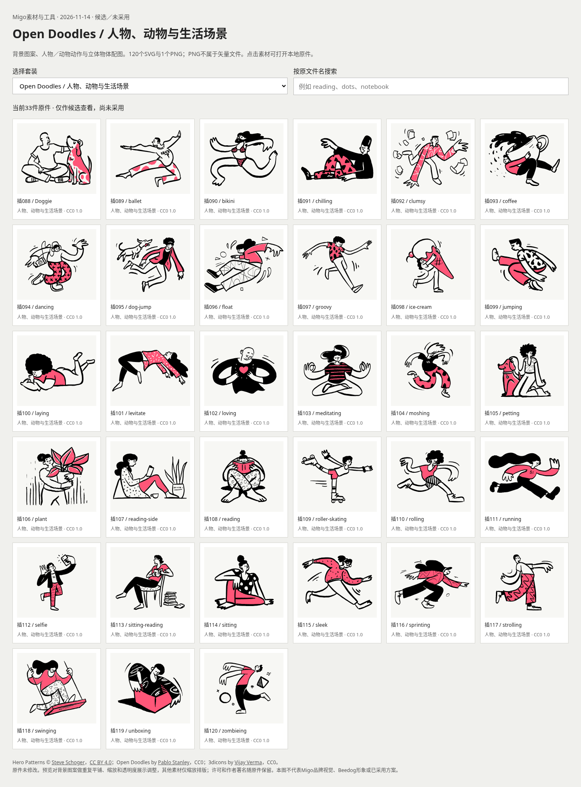

# 人物、动物与生活场景｜Open Doodles

2026-11-14入库；33个SVG原件。**候选／未采用**。

## 来源与范围

作者：[Pablo Stanley](https://www.pablostanley.com/work/open-doodles)。素材入口：[Open Doodles](https://www.opendoodles.com/)，授权说明：[About](https://www.opendoodles.com/about)。取2026-11-14官网首页公开的33个静态SVG直链，原始服务器为`opendoodles.s3-us-west-1.amazonaws.com`，合计2,285,881字节。

本批是官网文件快照，没有Git发布版本号。清单记录逐文件下载链接、ETag／Last-Modified响应头和SHA256；未把抓取日期伪装为官方发行版本。未重复保存PNG、GIF、Sketch源包或Blush其他系列。

## 许可与作者信息

作者官网明确将该套作品置于[CC0 1.0](https://creativecommons.org/publicdomain/zero/1.0/)。完整文本见[素材许可证](素材许可证.txt)，法律文本取自固定版本[SPDX镜像](https://raw.githubusercontent.com/spdx/license-list-data/31846481de7ea17d92f2f46fad76abe58b2e9bb0/text/CC0-1.0.txt)；具体作品的授权依据是作者About页面。

CC0不要求按CC BY方式署名；本库仍保留“Open Doodles by Pablo Stanley — https://www.opendoodles.com/ — CC0 1.0”便于溯源。

## 用法与限制

预览可见黑色手绘轮廓与粉色块，包含阅读、运动、休闲、拆箱和人物／动物互动。可作为一般内容配图候选，不能直接改称Migo原创角色。它已有明显造型语言，项目采用前应检查与品牌叙事、人物语境及其他视觉素材是否一致。

33个SVG已解析，未见嵌入位图、脚本及主动外部资源引用；Chromium实际读取通过。其他软件编辑兼容性未测试。

## 原件索引

| 编号 | 原件 |
| --- | --- |
| 插088 | [Doggie.svg](原件/Doggie.svg) |
| 插089 | [ballet.svg](原件/ballet.svg) |
| 插090 | [bikini.svg](原件/bikini.svg) |
| 插091 | [chilling.svg](原件/chilling.svg) |
| 插092 | [clumsy.svg](原件/clumsy.svg) |
| 插093 | [coffee.svg](原件/coffee.svg) |
| 插094 | [dancing.svg](原件/dancing.svg) |
| 插095 | [dog-jump.svg](原件/dog-jump.svg) |
| 插096 | [float.svg](原件/float.svg) |
| 插097 | [groovy.svg](原件/groovy.svg) |
| 插098 | [ice-cream.svg](原件/ice-cream.svg) |
| 插099 | [jumping.svg](原件/jumping.svg) |
| 插100 | [laying.svg](原件/laying.svg) |
| 插101 | [levitate.svg](原件/levitate.svg) |
| 插102 | [loving.svg](原件/loving.svg) |
| 插103 | [meditating.svg](原件/meditating.svg) |
| 插104 | [moshing.svg](原件/moshing.svg) |
| 插105 | [petting.svg](原件/petting.svg) |
| 插106 | [plant.svg](原件/plant.svg) |
| 插107 | [reading-side.svg](原件/reading-side.svg) |
| 插108 | [reading.svg](原件/reading.svg) |
| 插109 | [roller-skating.svg](原件/roller-skating.svg) |
| 插110 | [rolling.svg](原件/rolling.svg) |
| 插111 | [running.svg](原件/running.svg) |
| 插112 | [selfie.svg](原件/selfie.svg) |
| 插113 | [sitting-reading.svg](原件/sitting-reading.svg) |
| 插114 | [sitting.svg](原件/sitting.svg) |
| 插115 | [sleek.svg](原件/sleek.svg) |
| 插116 | [sprinting.svg](原件/sprinting.svg) |
| 插117 | [strolling.svg](原件/strolling.svg) |
| 插118 | [swinging.svg](原件/swinging.svg) |
| 插119 | [unboxing.svg](原件/unboxing.svg) |
| 插120 | [zombieing.svg](原件/zombieing.svg) |

[返回插画与矢量图](../README.md) · [统一来源与版本清单](../../素材清单.json)
