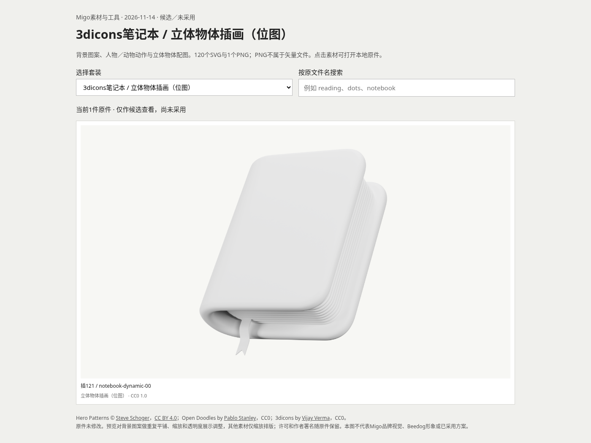

# 立体物体插画（位图）｜3dicons笔记本

2026-11-14入库；1个PNG原件。**候选／未采用**。

## 来源与范围

作者：[Vijay Verma／realvjy](https://github.com/realvjy/3dicons)。固定提交：[8884d59e68a7bae0e0e2163af5b6c2ad992c01c8](https://github.com/realvjy/3dicons/tree/8884d59e68a7bae0e0e2163af5b6c2ad992c01c8)。仅收录`static/notebook-dynamic-00.png`，1000×1000像素、RGBA透明PNG，220,231字节，已核对官方Git blob和本地SHA256。

这是一个白色立体笔记本的渲染位图，不是矢量图，也不是可旋转、换材质的三维模型。未声称下载了整套3dicons、多视角、多配色或Blender源文件。

## 许可

原作者仓库的[固定版本LICENSE](https://github.com/realvjy/3dicons/blob/8884d59e68a7bae0e0e2163af5b6c2ad992c01c8/LICENSE)为CC0，原文逐字节保留在[素材许可证](素材许可证.txt)。本库保留作者与来源，不额外套用根MIT。

## 用法与限制

适合测试物体配图、卡片装饰等小范围用途。原图偏白，使用时需要检查背景对比、图像尺寸与压缩效果。放大到1000像素以上不会获得新的细节；要改视角或材质需另找模型或制作，不能通过PNG预览宣称具备这些编辑能力。

## 原件索引

| 编号 | 原件 |
| --- | --- |
| 插121 | [notebook-dynamic-00.png](原件/notebook-dynamic-00.png) |

[返回插画与矢量图](../README.md) · [统一来源与版本清单](../../素材清单.json)
