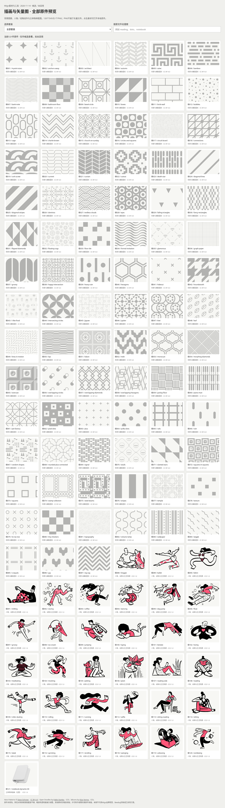

# 插画与矢量图

入库日期：2026-11-14。本批实际保存 **121个原件：120个SVG、1个PNG，合计2,743,670字节（约2.74 MB）**；PNG预览、许可证与管理资料另计。全部为候选／未采用，不代表Migo的品牌规范、原创角色或用户审美认可。

## 按用途查看

| 套装与目录 | 用途 | 实际范围 | 许可 |
| --- | --- | --- | --- |
| [背景图案／Hero Patterns](01_背景图案_HeroPatterns/README.md) | 可重复背景、分区纹理、辅助图形试验 | 87个SVG；237,558字节 | Steve Schoger，CC BY 4.0，使用时署名 |
| [人物动物／Open Doodles](02_人物动物_OpenDoodles/README.md) | 阅读、运动、休闲、人物与动物互动等配图 | 33个SVG；2,285,881字节 | Pablo Stanley，CC0 1.0 |
| [立体物体／3dicons](03_立体物体_3dicons/README.md) | 笔记本物体配图 | 1个1000×1000透明PNG；220,231字节 | Vijay Verma，CC0 1.0 |

每个套装只保留README、原件文件夹、PNG预览与许可证。官方原文件名便于检索，中文用途写在目录和本页。逐文件下载地址、固定版本／快照、SHA256、作者和许可统一维护在[素材清单](../素材清单.json)，不为每个SVG增加一份元数据文档。

## 下载边界与选择依据

先确定用途、许可、具体文件范围，再下载和校验。首批选择互补的背景、人物动作和立体物体三类，不按“网站上看到了就全部下载”扩张范围。

- Hero Patterns：取官方仓库固定提交的87个SVG压缩包，各解压一个原始SVG。ZIP容器Git blob、容器哈希和内部文件名已记录；不重复保存ZIP、Sketch源文件、网站代码或其他变体。
- Open Doodles：只取官网首页当时提供的33个静态SVG直链。保存2026-11-14快照、响应头和逐文件哈希，没有Git发布版本；未下载动图、重复PNG或Blush中的其他内容。
- 3dicons：只取作者仓库中一个明确可用的1000像素笔记本PNG，不将低分辨率网站装饰图、整套渲染或三维模型混入本批。

这次已覆盖背景图案、辅助图形、人物动作、动物互动及一个立体物体。植物主题包含在人物场景中；独立植物套装、信息图、抽象构成、产品说明图等尚未专项入库，按真实任务再选择，不创建空分类。图标请看[独立图标模块](../图标/README.md)。

## 如何查看与使用

GitHub可直接看上方总览和每套PNG，原件目录可下载SVG或PNG。SVG是矢量文件；PNG是位图，本批没有AI、EPS、PSD、动画或可编辑三维模型。

[交互预览HTML](管理资料/素材预览.html)提供套装筛选、文件名搜索和原件链接。GitHub文件页展示源码；下载仓库并保持目录结构后，在仓库根目录运行`python -m http.server 8000`，打开`http://localhost:8000/素材与工具/插画与矢量图/管理资料/素材预览.html`。本页无需远程素材或字体。

已在Chromium检查121个原件加载、四张截图、搜索、筛选及390px宽度无横向溢出；已人工打开三套独立预览，查看全部缩略图及笔记本大图。缩略图检查不等于逐路径编辑或所有软件兼容测试。Figma、Illustrator的实际导入与项目适配仍需另测。

[检查记录](管理资料/素材检查记录.json) · [预览生成脚本](../脚本/生成插画预览.py) · [返回素材与工具](../README.md)

## 许可与采用边界

Hero Patterns按CC BY 4.0保留作者、来源、许可链接及修改说明；可复用的署名在对应套装README。另两套CC0仍保留来源便于追溯。根目录MIT不覆盖这些外部作品，也不能据此承诺商标、肖像等其他权利。

原件字节未改。背景预览做缩放、重复平铺和透明度调整，人物与物体仅缩放排版。外部人物／动物配图不能登记为Migo原创Beedog形象；若真实项目采用，应另外登记素材编号、用途、署名与改动记录。
