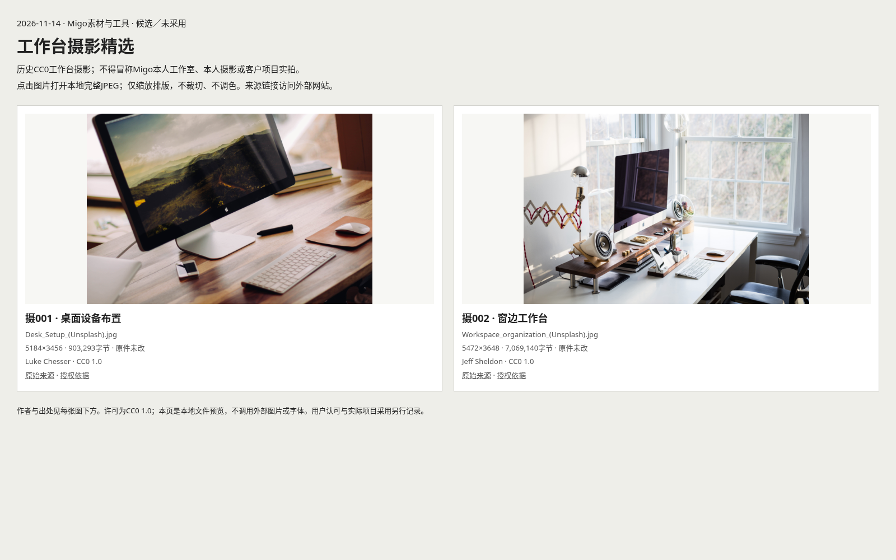

# 摄影图片

当前首批为**2个JPEG原件**，共7,972,433字节，均为候选／未采用。原图、预览和管理记录分别保存。

[进入工作台摄影精选](工作台场景/README.md)：逐文件原件、尺寸、作者、许可与用途说明。

## 怎样查看

GitHub直接查看上面的PNG，进入套装下载原件。每套只保留README、原件目录、预览PNG和许可证；HTML与检查JSON集中在管理资料，不为每张图片新增一套文档。

[本地预览HTML](管理资料/素材预览.html)在GitHub显示源码。下载并保留仓库结构后，从仓库根目录运行`python -m http.server 8000`，再访问浏览器中的对应HTML路径；点击图片可打开完整本地JPEG。

[检查记录](管理资料/素材检查记录.json) · [统一来源与版本](../素材清单.json) · [重建预览脚本](../脚本/生成摄影材质预览.py) · [返回素材与工具](../README.md)

图片已实际解码并查看预览，不等于用户认可或项目采用；没有改动品牌库、NED项目或网站。
