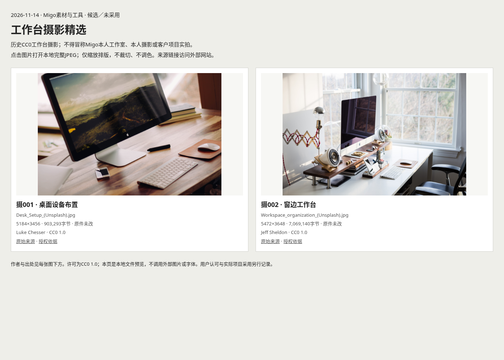

# 工作台摄影精选

2026-11-14入库，2个完整JPEG原件，共7,972,433字节。**候选／未采用**。

## 文件、作者与来源

| 编号／名称 | 原件与尺寸 | 作者 | 原始来源 |
| --- | --- | --- | --- |
| 摄001／桌面设备布置 | [Desk_Setup_(Unsplash).jpg](原件/Desk_Setup_%28Unsplash%29.jpg) · 5184×3456 | Luke Chesser | [作品页](https://commons.wikimedia.org/wiki/File:Desk_Setup_(Unsplash).jpg) |
| 摄002／窗边工作台 | [Workspace_organization_(Unsplash).jpg](原件/Workspace_organization_%28Unsplash%29.jpg) · 5472×3648 | Jeff Sheldon | [作品页](https://commons.wikimedia.org/wiki/File:Workspace_organization_(Unsplash).jpg) |

## 选择依据与下载边界

用于工作台布置、设备与桌面关系、窗边自然光的参考与排版试验。保留两张没有可识别人像的工作台JPEG；预览可见一张偏暖的木桌设备近景、一张明亮窗边桌面。均不是Migo本人工作室，也不作为Migo本人摄影或真实客户投放证明。

只下载上表两个Commons文件页给出的完整原图，不取960px网页缩略图，不下载同作者其他作品、不爬取整站。原件共7,972,433字节。保留源文件名；本地SHA256、Commons原图SHA1、原图时间及页面修订号见[统一清单](../../素材清单.json)。原件与源尺寸、字节数、SHA1核对通过。

## 许可与历史来源

两个Commons文件页均将**这两张具体作品**标记为CC0 1.0；档案记录了原作者、原Unsplash出处和历史许可说明。文件制作日期分别为2014-10-30、2017-05-23。这里依据Commons各自的授权页归档，不将当前Unsplash全站或其他新作品当作CC0。

[CC0完整法律文本](素材许可证.txt)来自固定版本[SPDX文本镜像](https://raw.githubusercontent.com/spdx/license-list-data/31846481de7ea17d92f2f46fad76abe58b2e9bb0/text/CC0-1.0.txt)，具体作品授权依据仍为上表各自的Commons文件页，固定修订链接在清单。法律文本镜像不是对照片另行授权。

## 使用与检查范围

只保存原图，预览仅缩放排版，没有裁切、调色、替换画面或AI生成。适合构图和环境参考；图中品牌设备及屏幕内容仍可见，项目采用时应检查具体画面及表达语境，不暗示品牌背书，也不用这些设备替代NED等项目的真实产品主体。

已用Pillow完整解码、Chromium按实际尺寸读取，检查原件链接和390px宽度。人工查看范围为本套PNG中两张完整构图的缩放预览；没有声称逐像素检查、Photoshop编辑测试或用户认可。

[返回分类目录](../README.md) · [检查记录](../管理资料/素材检查记录.json)
