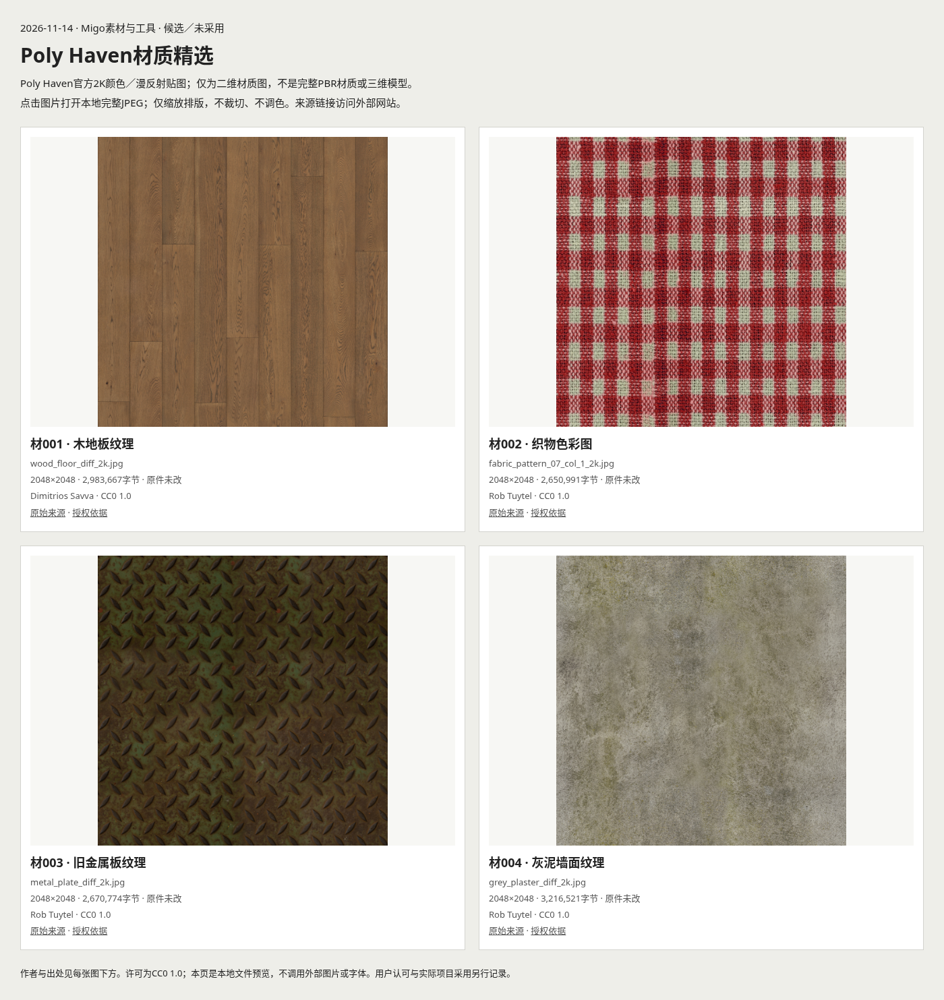

# Poly Haven材质精选

2026-11-14入库，4个完整JPEG原件，共11,521,953字节。**候选／未采用**。

## 文件、作者与来源

| 编号／名称 | 原件与尺寸 | 作者 | 原始来源 |
| --- | --- | --- | --- |
| 材001／木地板纹理 | [wood_floor_diff_2k.jpg](原件/wood_floor_diff_2k.jpg) · 2048×2048 | Dimitrios Savva | [作品页](https://polyhaven.com/a/wood_floor) |
| 材002／织物色彩图 | [fabric_pattern_07_col_1_2k.jpg](原件/fabric_pattern_07_col_1_2k.jpg) · 2048×2048 | Rob Tuytel | [作品页](https://polyhaven.com/a/fabric_pattern_07) |
| 材003／旧金属板纹理 | [metal_plate_diff_2k.jpg](原件/metal_plate_diff_2k.jpg) · 2048×2048 | Rob Tuytel | [作品页](https://polyhaven.com/a/metal_plate) |
| 材004／灰泥墙面纹理 | [grey_plaster_diff_2k.jpg](原件/grey_plaster_diff_2k.jpg) · 2048×2048 | Rob Tuytel | [作品页](https://polyhaven.com/a/grey_plaster) |

## 选择依据与下载边界

首批覆盖木材、织物、旧金属和灰泥四种不同表面，用于二维背景、合成底材和材质比较。预览中分别可见木板接缝与纹理、红白织物格纹、磨损金属凸纹、灰泥颗粒及斑驳；不把这些颜色或材质作为Migo品牌标准。

只取各资产官方API列出的**2K JPEG颜色／漫反射通道**，均为2048×2048，合计11,521,953字节。木材、金属和灰泥为`Diffuse`，织物取`col_1`这一种配色；不下载织物的另两种颜色、1K／4K／8K重复规格、PNG／EXR、法线、粗糙度、置换、HDRI或三维模型。这不是完整PBR套装。

## 来源、版本与许可

作者分工按Poly Haven官方资产元数据记录：木地板为Dimitrios Savva，其余三项为Rob Tuytel。来源为上表对应作品页，以及`https://api.polyhaven.com/info/资产ID`、`https://api.polyhaven.com/files/资产ID`，下载地址由官方files接口提供，未自行猜测URL。

版本采用2026-11-14官方API快照、每项`files_hash`、官方文件MD5／字节数和本地SHA256，不伪造Git版本；详见[统一清单](../../素材清单.json)。接口使用可识别的MigoDesignResearch User-Agent，本地预览不持续调用API。

[Poly Haven许可页](https://polyhaven.com/license)明确素材采用CC0且允许再分发，适用于这些材质文件；API服务的[条款](https://github.com/Poly-Haven/Public-API/blob/master/ToS.md)单独核对，不将API程序的AGPL当作素材许可。

[CC0完整法律文本](素材许可证.txt)取自固定版本[SPDX镜像](https://raw.githubusercontent.com/spdx/license-list-data/31846481de7ea17d92f2f46fad76abe58b2e9bb0/text/CC0-1.0.txt)，作品授权依据是Poly Haven官方许可页。保留作者与来源便于追溯。

## 使用与检查范围

JPEG原件字节未改，预览只缩放排版。使用时按实际画面测试纹理尺度、对比和产品透视；金属与灰泥有明显磨损特征，并非通用的干净商业背景。

已逐文件核对官方MD5和大小、Pillow完整解码、Chromium读取、原件链接和390px宽度。人工查看四张材质的完整缩放预览；未做三维渲染、接缝验证、色彩管理或Photoshop合成测试。

[返回分类目录](../README.md) · [检查记录](../管理资料/素材检查记录.json)
