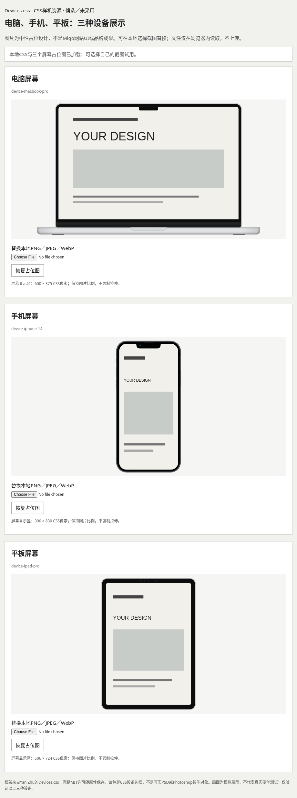

# Devices.css｜设备样机候选

作者：Yan Zhu（picturepan2）。适合把网站截图放入设备边框展示，当前未采用。

本套装只保留四个文件：本说明、原始[设备样机.css](设备样机.css)、PNG样张和[完整MIT许可](样机许可证.txt)。HTML与读取记录集中在上级管理资料。

来源：[官方固定提交](https://github.com/picturepan2/devices.css/tree/11846244977a4905a4fb9ac12bb2121e068d6147)，原始文件为`dist/devices.css`，59,293字节。仅改外部文件名，CSS内容与官方Git blob及SHA256核对一致；不声称是永远最新的版本。

本轮验证`device-macbook-pro`、`device-iphone-14`、`device-ipad-pro`三类；源码还能识别其他设备根类，但未逐个检查。此文件是CSS而非PSD，不能在Photoshop中双击智能对象来替换。

日常试用：保持目录结构，用浏览器打开[本地预览](../管理资料/样机预览.html)，选择自己的截图。代码接入：在HTML引入此CSS，按官方结构为`device-screen`的`img`设置截图路径；这一步尚未对Migo网站执行。

使用或复制原件时带上作者版权与MIT原文。占位图由本轮生成脚本绘制，只用于说明替换位置，不代表品牌视觉、网站UI或真实设备测试。

[返回样机入口](../README.md) · [来源、限制与使用步骤](../README.md#来源下载边界与许可)
