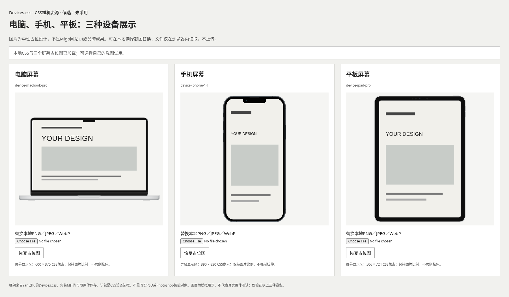

# 样机候选库

本轮实际下载 **1套Devices.css设备样机**，原始CSS文件59,293字节，约59 KB，作者Yan Zhu。已建立并验证电脑、手机、平板三种截图展示。当前为未采用候选，没有改变Migo品牌或网站设计。

**这是CSS设备边框，适合网页和作品集中的截图展示；不是写实摄影PSD，也没有Photoshop智能对象。** PNG为用本地CSS渲染的占位样张，不能算作已经完成的网站UI或真实硬件适配测试。

## 全部已验证样机预览



| 已验证展示 | 官方CSS类 | 屏幕显示区（CSS像素） | 使用方式 |
| --- | --- | --- | --- |
| 电脑 | `device-macbook-pro` | 600×375 | 放入网页或横向项目截图 |
| 手机 | `device-iphone-14` | 390×830 | 放入手机页面截图 |
| 平板 | `device-ipad-pro` | 506×724 | 放入平板页面截图 |

这些是本地CSS布局的显示尺寸，不是硬件原生分辨率。图片按比例包含在屏幕内，比例不符时可能留白，不会自动重新排版页面。源CSS另含其他设备根类，本轮没有逐一验证，不能把整个源包存在当作全部设备已验收。

[进入样机套装](Devices_CSS/README.md) · [原始CSS](Devices_CSS/设备样机.css) · [完整许可](Devices_CSS/样机许可证.txt)

## 怎么替换自己的设计

1. 下载并保留整个`样机`目录结构，用浏览器打开[管理资料中的预览HTML](管理资料/样机预览.html)。GitHub文件页显示源码，不能直接操作文件选择。
2. 在需要的设备下选择本地PNG、JPEG或WebP截图，屏幕内容会替换；“恢复占位图”可以重置。
3. 文件只通过当前浏览器的本地对象URL读取，不上传、不同步GitHub，关闭页面后不会自动保存你的选择。需要输出图片时可用浏览器截图；本页没有PSD导出或自动保存成品功能。
4. 浏览器若限制本地样式加载，可从仓库根目录运行`python -m http.server 8000`，访问`http://localhost:8000/素材与工具/样机/管理资料/样机预览.html`。

## 来源、下载边界与许可

- 实际来源：[picturepan2/devices.css官方仓库固定版本](https://github.com/picturepan2/devices.css/tree/11846244977a4905a4fb9ac12bb2121e068d6147)。作者：Yan Zhu。
- 下载范围：仅`dist/devices.css`与完整`LICENSE`；不重复收压缩版，不下载项目依赖或安装软件。CSS原件没有修改，文件在本库外部改为中文名。
- 许可：[Yan Zhu的MIT原文](Devices_CSS/样机许可证.txt)，允许依条款使用、修改和再分发。它与仓库根MIT分别保留，使用这套样机时要带上源版权与许可。
- 版本、原始URL、源Git blob及本地SHA256见[统一素材清单](../素材清单.json)。
- 本轮停止于这个明确许可的套装和三种使用验证。没有下载收费PSD、绕过登录或把“免费商用”视为可公开再分发原件。

## PSD候选：已核查，未上传原件

| 来源 | 实际核查结果 | 当前处理 |
| --- | --- | --- |
| [Graphicadi设备PSD](https://www.graphicadi.com/free-device-mockups/) | 页面虽提到照片源为CC0，PSD资源条款却写明仅个人使用、禁止销售和再分发 | 只留原页面，不上传PSD |
| [Lovely Mockups旧Behance帖子](https://www.behance.net/gallery/52777657/Macbook-pro-and-iphone-on-a-table-free-mockup-template)与[当前下载页](https://www.lovelymockups.com/product/macbook-pro-and-iphone-on-table/) | 旧帖写CC0，当前官网的文件规格不同，使用Free许可；[现行协议](https://www.lovelymockups.com/license/)禁止独立文件再分发。未能确认可取得与旧帖一致的原件 | 不把旧帖许可直接套用到当前不同下载项，不上传原件 |
| [Piotr Pawłowski名片PSD旧帖](https://dribbble.com/shots/2249368-Free-set-with-PSD-business-cards-templates) | 检索可读到作者CC0声明，但本轮未取得可用的PSD下载；直接请求仅返回202，未获得有效源文件 | 保留候选，未下载、不计入素材数量 |

外部作品原件和预览图未被复制入库。这里保存的是来源和访问结果；以后取得具体可再分发文件再检查入库，不把该表冒充PSD素材包。

## 本轮继续核查：PSD仍未入库

2026-11-14继续核查[2 Free Laptop Mockup PSD](https://myphotoshopbrushes.com/resources/3545/2-free-laptop-mockup-psd)：页面列作者Hazem Tawfik、两项PSD、101 MB、CC0，正常公开下载请求返回403 Forbidden，未获得下载地址、ZIP或PSD。尚未对照原作者及包内授权，也未检查图层、智能对象或替换结果；不能计为可用PSD。

[Super Dev Resources浏览器PSD](https://superdevresources.com/free-chrome-browser-psd-mockup-windows/)同时出现CC0与禁止转售的描述，许可表述存在差异；当前只保存入口，不将它无条件归为CC0。后续取得明确可再分发文件再入库，不用CSS样机或宣传图填充PSD数量。

## 简明目录

```text
样机/
├── README.md
├── 全部样机预览.png
├── Devices_CSS/       # CSS、PNG、许可、README
└── 管理资料/          # 一份HTML与一份检查JSON
```

[读取与替换检查记录](管理资料/样机检查记录.json)集中管理。维护时运行[生成样机预览.py](../脚本/生成样机预览.py)，依赖Playwright、Chromium和Pillow；然后运行素材校验。文件可读、用户认可、实际采用及效果验证分别记录。
