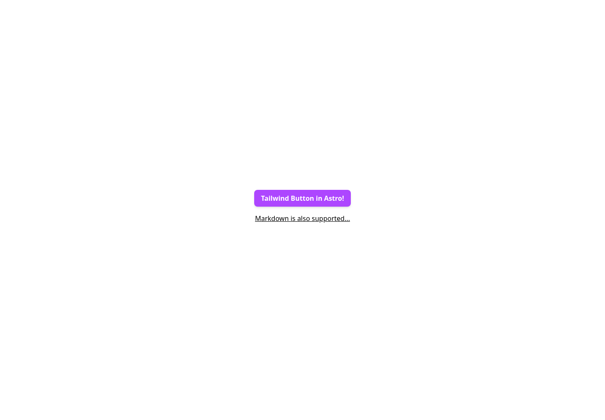

# Astro Tailwind官方示例

2026-11-14入库。类型：Astro示例工程；10个官方原件，4,234字节。**候选／未采用**。

[查看390px手机预览](手机预览.png)

## 下载范围与用途

来源为Astro官方`examples/with-tailwindcss`，保存10个运行所需文件。只保留原页面、Button组件、Markdown页面、布局、配置、CSS、原favicon。源README、编辑器配置和Codesandbox Dockerfile没有重复入库，本页提供中文运行说明。

这是框架集成示例：页面只显示一个紫色按钮和Markdown入口。它验证Tailwind编译、Astro组件及Markdown路由，不提供Migo首页、NED案例、双语或SEO方案。

[查看源码](原件/) · [原始依赖声明](原件/package.json) · [首页](原件/src/pages/index.astro) · [按钮](原件/src/components/Button.astro)。原件没有改字、改色或添加品牌内容。

## 运行与复现

本轮Node为24.19.0、npm为11.9.0；源码要求Node≥22.23.4。实际固定依赖包括Astro 7.4.12、Tailwind与Vite插件4.3.5、Vite 8.3.8，完整版本见集中记录。

将`原件/`复制到独立工作目录，把[集中保存的package-lock.json](../管理资料/构建环境/package-lock.json)复制到该工作目录根部，运行`npm ci --ignore-scripts`，然后`npm run build`或`npm run dev`。构建与安装只发生在独立目录，不在本素材库或Migo网站目录安装。

原始package.json使用官方版本范围，锁文件固定本轮实际解析版本；技术依赖文件保留英文功能名。没有额外引入产品代码、品牌字体或网站数据。

## 已验证和不能直接照用的部分

首页和Markdown互返、Tailwind实际样式、键盘Tab与Enter按钮操作通过。点击产生canvas彩纸已实际检查，PNG为点击前的原画面。

源按钮用`document.body.querySelector('button')`绑定全局首个按钮，不适合直接推断多实例组件正确；`confetti()`未传减少动效选项，系统减少动态效果时实测仍生成canvas。原件保留，但真实项目需重新处理作用域、可访问性与使用目的。本轮没有接入Migo网站。

## 许可、版本与原件核验

[官方源仓库](https://github.com/withastro/astro)，固定提交`5b7c3275cf2f4aa0d1685495f943cb19039a2e83`。每个文件保留原路径、下载链接、Git blob和SHA256，见[统一清单](../../素材清单.json)。

[完整MIT许可原文](源码许可证.txt)来自[官方固定版本](https://github.com/withastro/astro/blob/5b7c3275cf2f4aa0d1685495f943cb19039a2e83/LICENSE)，保留适用版权与许可；根MIT不替代它。原件已有的空白、注释与功能文件名原样保留。

[检查记录](../管理资料/网页检查记录.json) · [返回网页资源目录](../README.md)
