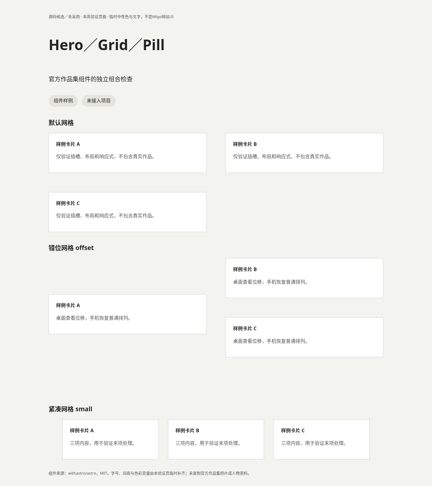

# Astro作品集基础组件

2026-11-14入库。类型：Astro组件片段；3个官方原件，2,336字节。**候选／未采用**。

[查看390px手机预览](手机预览.png)

## 下载范围与组件作用

从Astro官方`examples/portfolio/src/components/`只取三个文件：

| 原件 | 用途 | 已检查范围 |
| --- | --- | --- |
| [Hero.astro](原件/src/components/Hero.astro) | 标题、说明与插槽容器 | 标题与tagline输入、start对齐，桌面／手机字号变化 |
| [Grid.astro](原件/src/components/Grid.astro) | 默认、offset、small网格 | 默认桌面2列／手机1列；offset桌面位移／手机取消；small手机末项跨两列 |
| [Pill.astro](原件/src/components/Pill.astro) | 圆角标签容器 | 插槽文字及所需颜色变量的渲染 |

没有下载人物照片、演示案例、背景图、图标集合或完整官方作品集站点。这是三个组件片段，不是独立可运行的网站模板。

## 验证页来自哪里

[组件验证页.astro](../管理资料/组件验证页.astro)由本库编写，导入官方原件并补齐少量全局布局类、临时字号和中性色变量。截图中的卡片、文字、字号变量和排列示例属于验证内容，不是Astro官方成品设计或Migo作品。

原组件依赖`--text-*`、`--gray-0`、`--accent-*`及stack类等上下文；没有这些变量的工程不能按截图直接获得相同样式。重现脚本会复制它们到隔离Astro工程并构建，不会修改原文件。

## 可借鉴的方法与限制

可以研究Props、slot、局部样式和断点如何拆开维护；真实作品项目应自行确定内容顺序、卡片比例和视觉语言。错位网格不自动适合求职作品集；Pill的nowrap对长文案仍需另测，不能把短样例通过当作所有内容都通过。

已验证三种网格的桌面／手机计算样式和完整截图，未验证所有Props组合、长标题、读屏或真实设备；没有接入NED或Migo网站。

## 许可、版本与原件核验

[官方源仓库](https://github.com/withastro/astro)，固定提交`5b7c3275cf2f4aa0d1685495f943cb19039a2e83`。每个文件保留原路径、下载链接、Git blob和SHA256，见[统一清单](../../素材清单.json)。

[完整MIT许可原文](源码许可证.txt)来自[官方固定版本](https://github.com/withastro/astro/blob/5b7c3275cf2f4aa0d1685495f943cb19039a2e83/LICENSE)，保留适用版权与许可；根MIT不替代它。原件已有的空白、注释与功能文件名原样保留。

[检查记录](../管理资料/网页检查记录.json) · [返回网页资源目录](../README.md)
