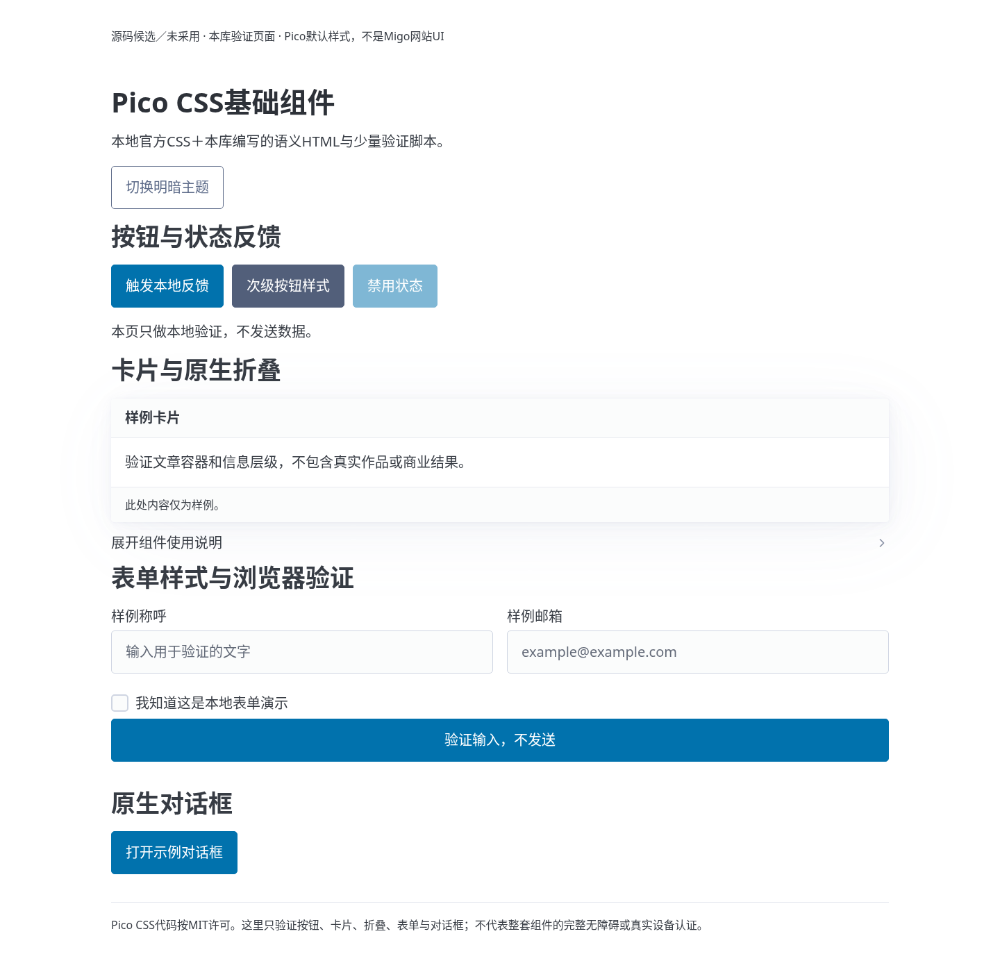

# Pico CSS基础组件

2026-11-14入库。类型：CSS组件基础；1个官方原件，83,319字节。**候选／未采用**。

[查看390px手机预览](手机预览.png)

## 下载范围与来源版本

来源为Pico官方代码仓库，源版本2.1.1。只收录`css/pico.min.css`，外部文件名改为[基础组件样式.css](原件/基础组件样式.css)，内容逐字节不变。作者Pico／Lucas Larroche，83,319字节，约83.32 KB；没有另存未压缩版、颜色变体、SCSS、文档源码或安装包。

Pico代码按MIT许可；其网站文档标注CC BY-SA 4.0，本批没有复制文档内容来冒充MIT源码。

## 怎样看与怎样使用

[本地基础组件验证页](../管理资料/基础组件验证.html)由本库编写，使用语义HTML与这份CSS。下载完整目录后可用浏览器打开；若本地相对路径受限，从仓库根目录运行`python -m http.server 8000`并访问对应HTML。

验证页展示按钮、禁用状态、卡片、details、表单和dialog。Pico负责样式；原生折叠、表单校验和对话框由浏览器提供，主题开关、反馈文字及打开／关闭连接脚本由本库编写，不属于Pico附送的JavaScript组件。

## 本轮检查

桌面1440px、手机390px均无横向溢出；明暗主题切换、键盘触发反馈、details展开、无效邮箱拒绝、有效输入反馈、Escape／按钮关闭对话框与焦点返回通过。表单没有发送或保存输入，样例不接服务端。

这里不是正式联系表单、完整无障碍审计或整套Pico组件验收。Pico有全局HTML样式，与Tailwind混用需要另外隔离或检查冲突；本批只作独立比较，不改变Migo网站技术方案。

## 许可、版本与原件核验

[官方源仓库](https://github.com/picocss/pico)，固定提交`a07563ddc856e6ed31a740e33b0397814227d469`。每个文件保留原路径、下载链接、Git blob和SHA256，见[统一清单](../../素材清单.json)。

[完整MIT许可原文](源码许可证.txt)来自[官方固定版本](https://github.com/picocss/pico/blob/a07563ddc856e6ed31a740e33b0397814227d469/LICENSE.md)，保留适用版权与许可；根MIT不替代它。原件已有的空白、注释与功能文件名原样保留。

[检查记录](../管理资料/网页检查记录.json) · [返回网页资源目录](../README.md)
