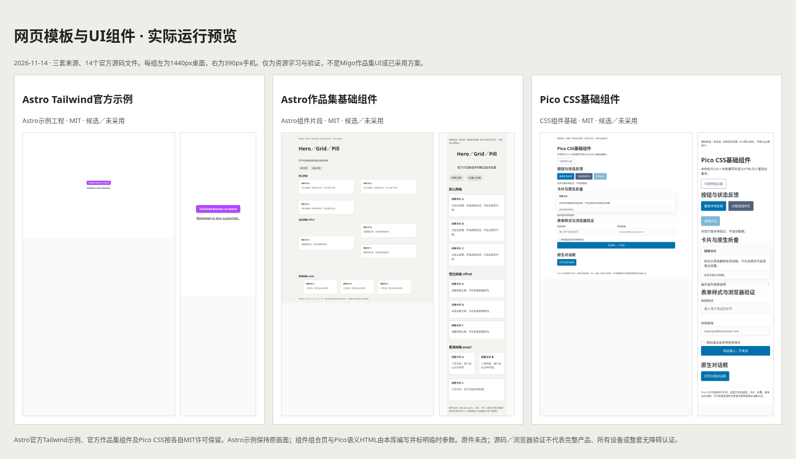

# 网页模板与UI组件

2026-11-14首批归档：**三套资源、14个官方源码文件，共89,889字节（约89.89 KB）**。许可、验证代码、锁文件与PNG另计。全部为候选／未采用，未改动Migo网站或品牌项目。

| 资源 | 实际入库范围 | 用途与边界 |
| --- | --- | --- |
| [Astro＋Tailwind官方示例](Astro_Tailwind示例/README.md) | 10个运行文件：配置、按钮、页面、Markdown、CSS与favicon | 学习Astro与Tailwind集成、路由与组件插槽；不是已排好完整作品集的视觉模板 |
| [Astro作品集基础组件](Astro_作品集组件/README.md) | Hero、Grid、Pill，3个官方Astro文件 | 首屏文字容器、响应式网格、标签；是组件片段，需要项目环境及少量全局变量 |
| [Pico CSS基础组件](Pico_CSS基础组件/README.md) | 1份官方压缩CSS | 研究语义HTML的基础样式；验证页覆盖按钮、卡片、折叠、表单、对话框，不是独立JavaScript组件库 |

“模板”提供工程或页面骨架，“组件”提供局部结构和行为，“CSS基础样式”提供HTML元素的外观。它们不能因为有预览图就被视为Migo正式UI或已完成作品集。

## 为什么收这些，为什么只收这些

Astro＋TypeScript＋Tailwind与网站既有技术建议相关，先保存一个最小、可真实构建的官方示例，方便核对框架集成与内容路由。作品集组件另选三个不依赖外部照片的基础结构，避免复制作者人像、虚构案例和整套视觉。Pico用于比较语义HTML和基础状态，不自动改变Migo的技术选型。

首批停止于上述14个固定文件。不批量下载主题市场模板、第三方摄影、字体、壁纸、整站源码、付费组件、React/Vue组件库或整套Pico变体。Astro示例有原作者favicon，保持来源身份，不替换成Migo标志。没有安装桌面软件。

## 先看预览，再决定是否需要代码

各目录都有真实构建／运行的桌面与手机PNG。GitHub文件页可以看PNG和源码；`.astro`不能直接当HTML双击运行。

- Astro示例须在支持所需Node版本的环境中安装依赖并构建。官方原package.json与配置保持原样，复现方式见套装README。
- 作品集组件的组合页由本库编写，补齐临时字号、间距和颜色变量。没有把验证参数当作品牌规范，也没有复制官方作品集的个人内容或照片。
- [Pico本地验证HTML](管理资料/基础组件验证.html)可下载后按目录运行。折叠、表单验证与dialog来自浏览器原生能力；本库脚本只连接操作，不能把这些行为都归功于CSS。

可从仓库根目录运行`python -m http.server 8000`，浏览`http://localhost:8000/素材与工具/网页模板与UI组件/管理资料/基础组件验证.html`。表单不发送或保存输入。静态HTML样例没有部署到GitHub Pages。

## 已验证与限制

已在隔离临时目录完成Astro生产构建，并实际访问首页、Markdown页和组件组合页。桌面1440×1000、手机390×844共六张截图，均无横向溢出；另有一张总览。

已检查示例首页／Markdown互返、按钮Tab／Enter触发、默认／错位／紧凑网格、Pico明暗切换、原生折叠、无效邮箱拒绝／有效输入反馈、对话框Escape与焦点返回。浏览器检查期间没有外部网络请求。

已发现限制：官方彩纸按钮选择全局第一个button，且系统减少动态效果时仍生成canvas；这是示例代码，生产采用前需要重新处理组件作用域和减少动效。Pico会改变全局HTML外观，与Tailwind同时引入前需要隔离或冲突评估，本批没有把它们混合成网站方案。

未进行完整TypeScript类型检查、读屏审计、真实手机测试、全套Pico组件验收、正式网站性能或商业结果验证。读取、用户认可、项目采用分别记录。

## 版本、许可与文件结构

原件按固定Git提交保存，逐文件核对Git blob与SHA256，完整MIT声明分别保留。依赖与构建产物只在临时目录，未将`node_modules`或`dist`提交到仓库。

各套装只保留README、原件、许可证、桌面和手机PNG；管理资料集中保存验证页、依赖锁文件、总览HTML与检查JSON。源码中的`package.json`、`astro.config.mjs`、文件导入路径等保留必要功能名称，普通说明使用中文。

[完整检查记录](管理资料/网页检查记录.json) · [锁文件](管理资料/构建环境/package-lock.json) · [重现脚本](../脚本/生成网页资源预览.py) · [来源总清单](../素材清单.json)

重现命令：`python 素材与工具/脚本/生成网页资源预览.py`。需要Node/npm、Playwright与Chromium；脚本按锁文件执行`npm ci --ignore-scripts`并构建，只写临时目录和本模块预览。软件和依赖不会因此成为本库原件。若仅浏览Pico样例，无需Node或依赖安装。

## 与现有研究的关系

[已有Dennis结构与交互研究](../../设计研究库/04_网站与数字体验案例/Dennis-Snellenberg-结构交互与动效.md)提供“先明确内容与操作路径，再加入视觉反馈”的参考。本批只读取已有研究的分析与限制，不重新冒称看过外站，也不复制Dennis源码、视觉资产或精确动效。可迁移的是组件拆分与普通浏览路径的思路；实际项目尚未采用。

[整理进度](../整理进度.md) · [返回素材与工具](../README.md)
