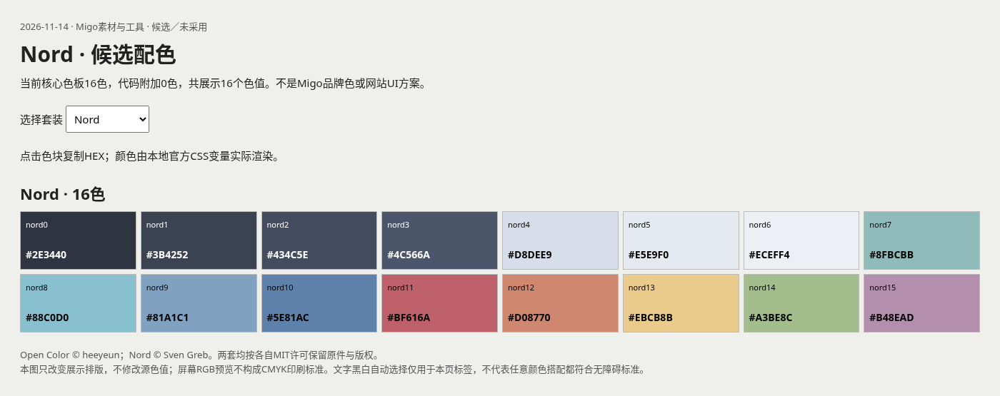

# Nord配色资源

2026-11-14入库；官方版本0.2.1，固定提交`1cef71605416a222e57225b544540ce0fcec18d4`。作者：Sven Greb / Nord。**候选／未采用**，不代表用户已认可或Migo品牌已采用。

## 实际文件

| 文件 | 原始文件名 | 数量／作用 |
| --- | --- | --- |
| [色板.ase](原件/色板.ase) | `src/swatches/nord.ase` | ASE · 16个色值 |
| [色板.gpl](原件/色板.gpl) | `src/swatches/nord.gpl` | GPL · 16个色值 |
| [色彩变量.css](原件/色彩变量.css) | `src/nord.css` | CSS · 16个色值 |

## 结构与用途

16个颜色沿用官方命名`nord0`—`nord15`。预览可见深浅蓝灰、中间蓝青和若干柔和强调色；适合比较有限颜色集如何组织背景、文字与强调关系。

ASE、GPL和CSS的16个RGB色值一致。该套色板源于代码高亮与UI场景；可以研究其颜色关系，但不能由此认定它就是Migo品牌定位需要的配色，或任意两色都适合正文阅读。

## 来源与下载边界

[作者官方仓库](https://github.com/nordtheme/nord) · [官方展示网站](https://www.nordtheme.com/)。只取固定提交内的ASE、GPL及CSS三项，源版本号为0.2.1；未下载ACO、应用主题、壁纸、终端插件或程序依赖。原件合计6,354字节，许可与PNG另计。

## 许可与原件核验

[该套完整MIT许可证](配色许可证.txt)从[官方固定版本](https://github.com/nordtheme/nord/blob/1cef71605416a222e57225b544540ce0fcec18d4/license)逐字节保存，使用或再分发时保留适用版权与许可；仓库根MIT不替代这份声明。

每个原件核对官方Git blob与SHA256；源色值、内部名称和文件内容没有修改，只将外部文件名改为中文。格式解析和浏览器渲染已核对，未声称实际在Photoshop、Illustrator或GIMP中导入成功。屏幕RGB预览不等于CMYK印刷色样。

[返回配色总目录](../README.md) · [统一来源清单](../../素材清单.json) · [集中检查记录](../管理资料/配色检查记录.json)
