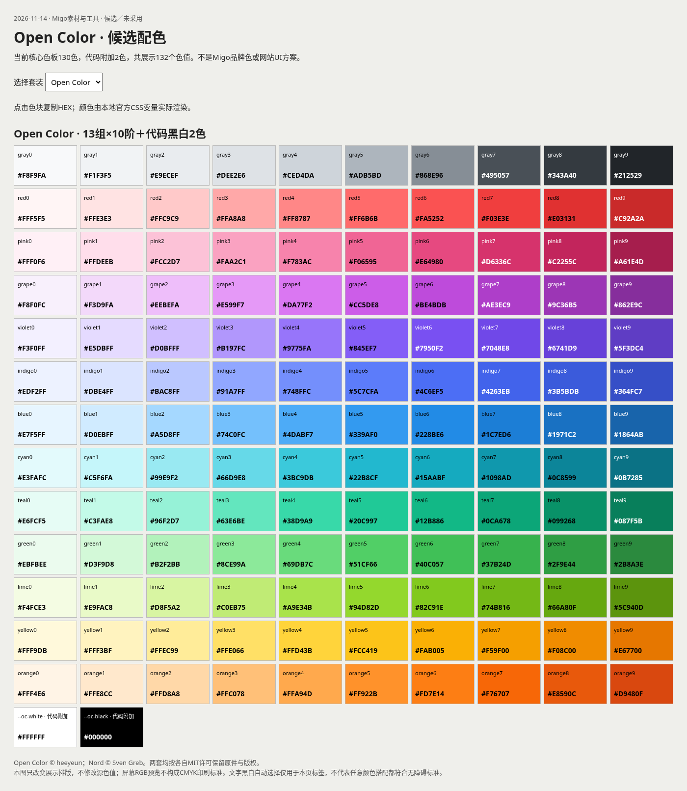

# Open Color配色资源

2026-11-14入库；官方版本1.9.1，固定提交`3a716ee1f5ff5456db33cb8a6e964afdca1e7bc3`。作者：Jeong Heeyeun / heeyeun。**候选／未采用**，不代表用户已认可或Migo品牌已采用。

## 实际文件

| 文件 | 原始文件名 | 数量／作用 |
| --- | --- | --- |
| [色板.ase](原件/色板.ase) | `docs/asset/download/open-color_1.9.1.ase` | ASE · 130个色值 |
| [色板.gpl](原件/色板.gpl) | `docs/asset/download/open-color_1.9.1.gpl` | GPL · 130个色值 |
| [色彩变量.css](原件/色彩变量.css) | `open-color.css` | CSS · 132个色值 |
| [open-color.json](../管理资料/源数据/open-color.json) | `open-color.json` | JSON · 132个色值 |

## 结构与用途

13组包含灰阶、红、粉、葡萄紫、紫罗兰、靛蓝、蓝、青、青绿、绿、黄绿、黄和橙，每组10阶（0—9）。预览按官方GPL的顺序显示，可比较浅色背景、中间强调色和深色文字的候选；同一编号不保证不同色相拥有相同对比度。

**官方格式存在差异**：ASE、GPL各130色，CSS和JSON各132色。额外的`#ffffff`与`#000000`只在代码文件里，已在预览中标“代码附加”；没有修改ASE／GPL来补齐。

用于研究色阶组织与变量命名，不建议把全部颜色作为一个品牌的主色，也不按索引机械决定按钮或正文颜色。真实项目应选择少量颜色并验证其组合、面积和对比。

## 来源与下载边界

[作者官方仓库](https://github.com/yeun/open-color) · [官方展示网站](https://yeun.github.io/open-color/)。只取固定提交下的1.9.1 ASE、GPL、根CSS和JSON；旧版色板、ACO、网站源码、框架转换包和依赖没有入库。原件合计22,906字节，许可与PNG另计。

## 许可与原件核验

[该套完整MIT许可证](配色许可证.txt)从[官方固定版本](https://github.com/yeun/open-color/blob/3a716ee1f5ff5456db33cb8a6e964afdca1e7bc3/LICENSE)逐字节保存，使用或再分发时保留适用版权与许可；仓库根MIT不替代这份声明。

每个原件核对官方Git blob与SHA256；源色值、内部名称和文件内容没有修改，只将外部文件名改为中文。格式解析和浏览器渲染已核对，未声称实际在Photoshop、Illustrator或GIMP中导入成功。屏幕RGB预览不等于CMYK印刷色样。

[返回配色总目录](../README.md) · [统一来源清单](../../素材清单.json) · [集中检查记录](../管理资料/配色检查记录.json)
