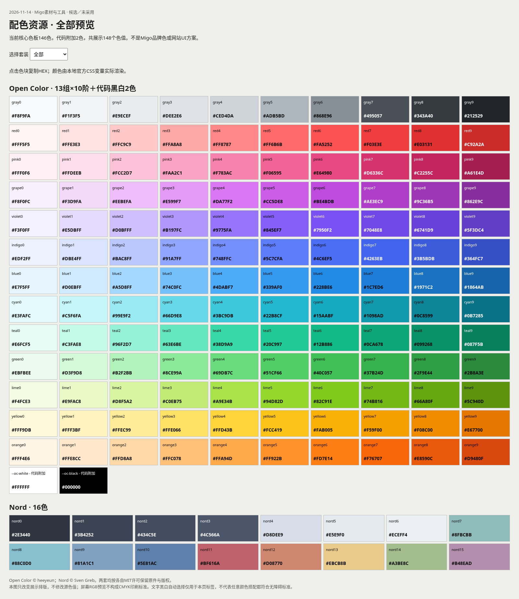

# 配色资源

2026-11-14首批入库：**2套官方色板体系、7个原件文件，共29,260字节（约29.26 KB）**，附各自MIT许可证与真实预览。全部为候选／未采用，不是Migo品牌定稿或网站UI方案。

| 套装 | 官方核心色板 | 代码中的颜色 | 原件格式与用途 |
| --- | --- | --- | --- |
| [Open Color](Open_Color/README.md) | ASE／GPL各130色：含灰阶在内的13组×10阶 | CSS／JSON各132色，额外含黑、白 | ASE用于支持该格式的软件；GPL用于GIMP等；CSS用于变量研究，JSON集中管理 |
| [Nord](Nord/README.md) | ASE／GPL各16色 | CSS为16色 | ASE、GPL、CSS三种官方文件 |

两套核心色板合计146色，预览额外展示Open Color代码中的黑白2色，共148个色值。**不同格式和重复色值不重复算作独立色板套装**；7项原件按实际文件计数。

## 为什么先收这两套

Open Color用于研究同一色相的明暗层级、背景与强调色的选择；Nord用于比较较少颜色如何形成中性色和强调色关系。选取依据是明确的结构、官方可下载文件、MIT再分发许可与较小体积，不以流行度代替品牌判断，也不把它们机械拼成Migo方案。

边界只含两套固定提交中的指定ASE、GPL、CSS，以及一份Open Color源JSON。没有抓取Adobe Color、Color Hunt等网站全部用户作品，没有额外保存旧版本、ACO、SCSS或依赖包。源码、许可和预览以清单登记范围为准。

## 文件格式与使用

| 格式 | 是什么 | 如何使用与本轮检查范围 |
| --- | --- | --- |
| ASE | Adobe Swatch Exchange，交换色板文件 | 供支持ASE的软件导入；已检查RGB块和颜色值，未实际测试Photoshop／Illustrator导入 |
| GPL | GIMP Palette，纯文本色板文件 | 用于GIMP、Inkscape等支持该格式的软件；这里的扩展名不是GPL许可证，两个套装实际均为MIT |
| CSS | 带颜色变量的样式文件 | 已在本地Chromium实际加载并逐项检查计算后的RGB；未接入Migo网站 |
| JSON | 结构化源色值 | Open Color官方原始数据，用于跨格式核对，集中在管理资料，不需要为查看预览手动打开 |
| PNG | 可直接看的预览图 | 只是展示，不是可导入色板，也不是印刷打样 |

GitHub直接看PNG，下载需要的ASE或GPL。源色值按RGB解释；转换到CMYK、选择印刷纸张或做专色须另行验证。原件不改色、不改内部色名，外部中文文件名与官方原路径对应关系见[统一清单](../素材清单.json)。

[本地交互预览](管理资料/配色预览.html)提供套装筛选与HEX复制。GitHub文件页显示源码；下载并保留仓库结构后，在根目录运行`python -m http.server 8000`，再访问`http://localhost:8000/素材与工具/配色资源/管理资料/配色预览.html`。直接打开本地文件时，浏览器可能限制剪贴板；仍可手动复制可见HEX。

## 目录与维护

每个套装只保留README、原件文件夹、PNG预览和完整MIT许可。源JSON、预览HTML和检查JSON集中在管理资料，不为每个颜色创建文件。

已核对官方Git blob、本地SHA256、ASE／GPL的核心颜色和次序、CSS与JSON的色值差异；已检查浏览器实际颜色、套装筛选、键盘复制与390px宽度。人工查看记录与自动检查分别维护，标签对比度仅涉及本预览黑白文字，不代表任意网页配色均符合无障碍标准。

[检查记录](管理资料/配色检查记录.json) · [重建预览脚本](../脚本/生成配色预览.py) · [整理进度](../整理进度.md) · [返回素材与工具](../README.md)
