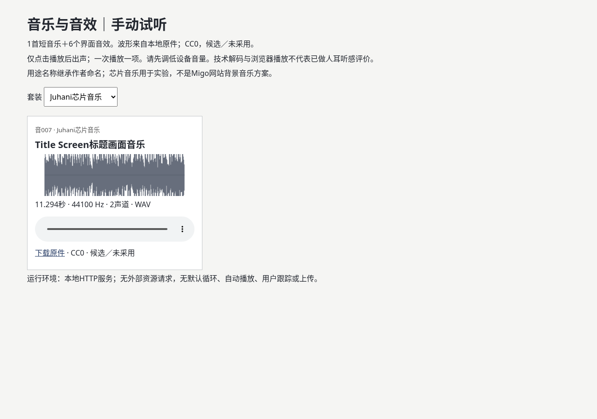

# Juhani芯片音乐

作者：Juhani Junkala，发布账户SubspaceAudio。来源：`5 Chiptunes (Action)`，页面发布于2016-04-17，2026-11-14下载快照，无可核实的Git提交或语义版本。只收录`Title Screen`一首短音乐，1,992,686字节，CC0，候选／未采用。

## 原件

[标题画面.wav](原件/标题画面.wav)，编号音007。原压缩包路径为`Juhani Junkala [Retro Game Music Pack] Title Screen.wav`。11.294秒、44,100 Hz、双声道、PCM 16位；只改中文外部名称，没有转码、裁切或改变音量。

作者页面以chiptune／VGM／SID标记整包，并声称五首曲目均可无缝循环。本库只选标题画面用于音乐播放实验，未验证循环接缝，不把游戏音乐自动定为Migo品牌背景音乐。Level 1／2／3及Ending均未入库。

## 原始来源与授权

- [作者发布页](https://opengameart.org/content/5-chiptunes-action)：本次实际读取，署名SubspaceAudio，标CC0。
- [作者原ZIP](https://opengameart.org/sites/default/files/5%20Action%20Chiptunes%20By%20Juhani%20Junkala.zip)：包内`INFO.txt`自述Juhani Junkala为音乐作者，并明确这些曲目以CC0发布。原声明、字节哈希、ZIP哈希与包内路径见[总清单](../../素材清单.json)的音乐套装清单。
- [完整CC0法律文本](素材许可证.txt)：固定SPDX镜像法律正文；它不替代上述作者声明。CC0不要求署名，保留作者用于追溯。

已完整解码并由浏览器用户手势触发播放，时长与采样参数经过解析；人耳试听、跨设备音量与实际项目用途待确认。[试听方法](../README.md) · [统一试听HTML](../管理资料/音频试听.html)。访问日期：2026-11-14。
