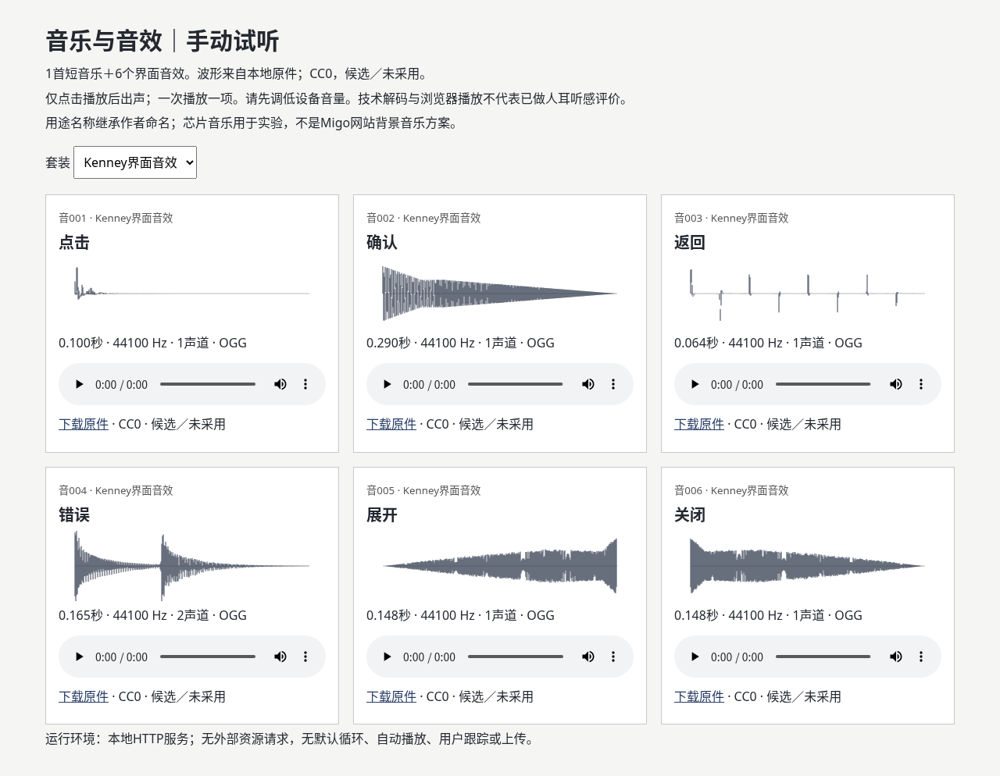

# Kenney界面音效

作者：Kenney。版本：压缩包`Interface Sounds (1.0)`，创建日期2020-02-11；2026-11-14取得。六个原件共47,963字节，CC0，候选／未采用。

## 范围与原名

| 中文原件 | 作者压缩包内路径 | 编号 |
| --- | --- | --- |
| [点击](原件/点击.ogg) | Audio/click_001.ogg | 音001 |
| [确认](原件/确认.ogg) | Audio/confirmation_001.ogg | 音002 |
| [返回](原件/返回.ogg) | Audio/back_001.ogg | 音003 |
| [错误](原件/错误.ogg) | Audio/error_001.ogg | 音004 |
| [展开](原件/展开.ogg) | Audio/open_001.ogg | 音005 |
| [关闭](原件/关闭.ogg) | Audio/close_001.ogg | 音006 |

只选六种操作的001版本，未把全部100个音效放入仓库；仅改外部文件名，字节内容不变。中文用途继承作者命名，实际听感、品牌适配和用户认可待确认。

## 官方来源与许可

- [Kenney本人发布页](https://opengameart.org/content/interface-sounds)：发布账户Kenney，标CC0，列100个OGG；本次实际读取。
- [作者官网入口](https://kenney.nl/assets/interface-sounds)：作为交叉入口；本轮命令行未成功取得该页完整正文，不依赖该页做额外事实判断。
- [原ZIP](https://opengameart.org/sites/default/files/kenney_interfaceSounds.zip)：包内`License.txt`明确Created/distributed by Kenney、CC0及非强制署名。声明原文与哈希见[总清单](../../素材清单.json)的音乐套装清单，原ZIP未重复提交。
- [完整CC0法律文本](素材许可证.txt)：来自固定SPDX文本镜像，与其他CC0套装同一法律正文；作者的素材授权证据另见上述包内声明。

解码和浏览器播放已通过，PNG只记录真实波形；未做人耳听感评价或项目接入。[试听方法与完整时长](../README.md) · [统一试听HTML](../管理资料/音频试听.html)。访问日期：2026-11-14。
