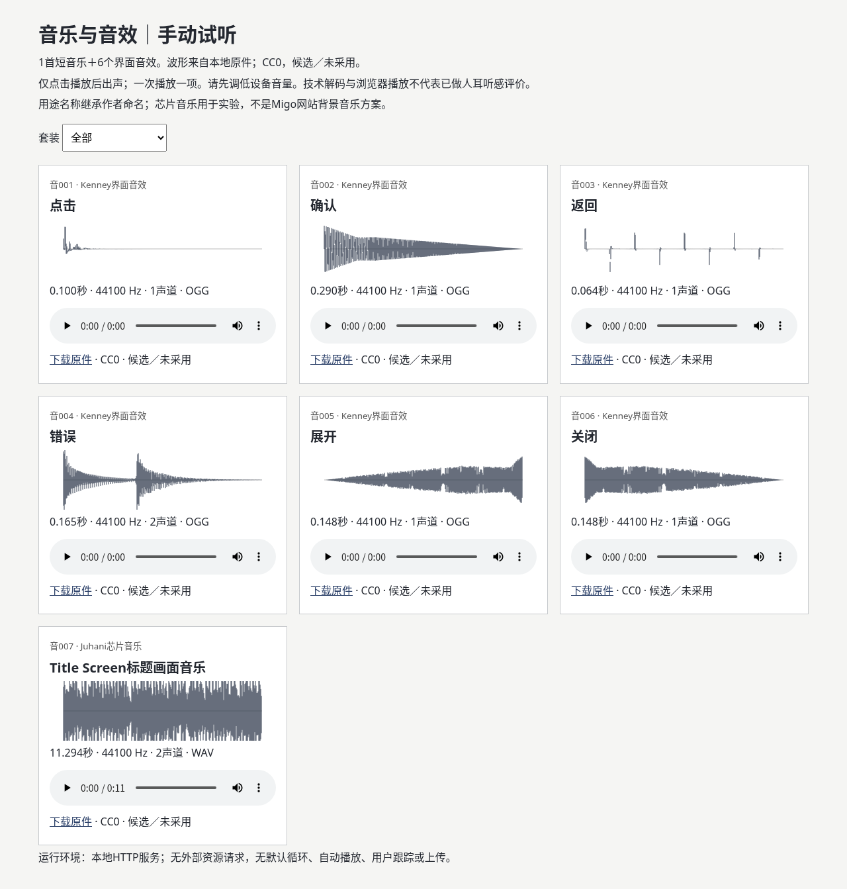

# 音乐与音效

入库日期：2026-11-14。本批 **1首短音乐＋6个界面音效，共7个原件、2,040,649字节（约2.04 MB）**。全部为CC0候选／未采用，人耳听感与是否适合项目待用户确认。没有为Migo网站接入声音。

PNG只显示波形与参数，不能发声；音效不足一秒，浏览器播放器显示`0:00`属于秒级时间显示，实际时长见下表。波形来自完整原件解码后的单声道混合，不是响度、听感或无缝循环认证。

## 原件与来源

| 编号 | 原件 | 时长 | 格式与声道 | 作者与许可 |
| --- | --- | ---: | --- | --- |
| 音001 | [点击](Kenney界面音效/原件/点击.ogg) | 0.100秒 | OGG Vorbis，单声道 | Kenney，CC0 |
| 音002 | [确认](Kenney界面音效/原件/确认.ogg) | 0.290秒 | OGG Vorbis，单声道 | Kenney，CC0 |
| 音003 | [返回](Kenney界面音效/原件/返回.ogg) | 0.064秒 | OGG Vorbis，单声道 | Kenney，CC0 |
| 音004 | [错误](Kenney界面音效/原件/错误.ogg) | 0.165秒 | OGG Vorbis，双声道 | Kenney，CC0 |
| 音005 | [展开](Kenney界面音效/原件/展开.ogg) | 0.148秒 | OGG Vorbis，单声道 | Kenney，CC0 |
| 音006 | [关闭](Kenney界面音效/原件/关闭.ogg) | 0.148秒 | OGG Vorbis，单声道 | Kenney，CC0 |
| 音007 | [Title Screen标题画面音乐](Juhani芯片音乐/原件/标题画面.wav) | 11.294秒 | WAV PCM 16位，双声道 | Juhani Junkala，CC0 |

全部44,100 Hz。详细原名、下载URL、压缩包SHA256、包内路径、逐文件哈希及作者许可声明统一保存在[素材清单](../素材清单.json)，不逐项增加JSON。来源说明见[Kenney套装](Kenney界面音效/README.md)与[Juhani套装](Juhani芯片音乐/README.md)。

## 怎样试听

1. GitHub上先看PNG和README；音频文件可下载到播放器播放。GitHub文件页的HTML显示源码，不能把它当作已发布试听网站。
2. 下载仓库并保持目录，在仓库根目录运行`python -m http.server 8000`。
3. 打开`http://localhost:8000/素材与工具/音乐与音效/管理资料/音频试听.html`，点击对应播放按钮；也可从[试听HTML](管理资料/音频试听.html)定位文件。

页面使用本地音频，不自动播放或循环，一次只播放一项；建议首次先降低设备音量。筛选套装时暂停播放。无需上传到第三方或安装播放器插件。没有新增GitHub Pages部署。

## 下载边界与选择依据

- 先核实发布者、原页CC0标记和压缩包作者声明，再下载；不是看到链接就收全站。
- Kenney官方账户发布的100个OGG中只保留六种操作名称的`001`版本。选择依据是用途覆盖与控制重复，不代表六种声音已经通过主观听感评选；余下94个不入库。
- 作者SubspaceAudio发布的五首音乐中只保留`Title Screen`，用于音乐播放和短循环实验；其余四首不入库。页面标签为chiptune／VGM／SID，不能据此推荐为Migo品牌氛围音乐；作者声称五曲可无缝循环，本库未单独完成循环衔接试听。
- 原压缩包仅临时下载检查：音效834,536字节、音乐49,639,688字节（音乐包约49.64 MB）。仓库只提交选中的约2.04 MB音频，不重复保存ZIP、封面、推广入口或其他曲目。原件没有转码、裁切、降采样或归一化。
- FreePD原站已停止原来的资源服务，未从未经核实的镜像下载曲目。本批不追加电影／流行歌曲、整站音库或软件安装包。

## 许可、验收和后续使用

两套各附完整CC0法律文本。**授权依据是作者对对应压缩包内容的CC0声明**；SPDX镜像只提供完整法律文本，不替作者授予权利。CC0不要求署名，但保留作者和来源便于追溯。根目录MIT不替代音频许可。

已完成ffprobe参数解析、FFmpeg完整解码、七项浏览器解码与用户手势播放、无自动播放、互斥播放、桌面／390px截图和无外部请求检查。[技术记录](管理资料/音频检查记录.json) · [手机预览](管理资料/手机试听预览.png) · [重建脚本](../脚本/生成音频预览.py)。已查看桌面与手机PNG，**没有把技术播放测试记为人耳试听或用户认可**；未测Safari／真实手机、循环接缝、跨设备响度和项目效果。

网站若以后采用，先确认具体用途与听感，再设独立声音开关、用户触发、可暂停和等价视觉反馈；重要信息不能只靠声音传达。此次没有决定网站需要声音。

[返回素材入口](../README.md) · [工具与脚本](../工具/README.md) · [整理进度](../整理进度.md)
